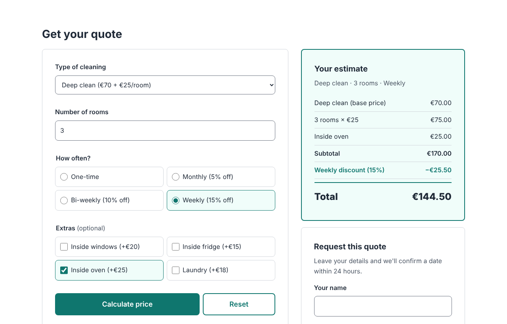
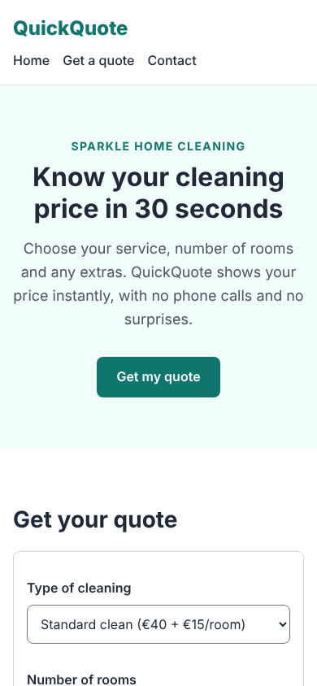

# QuickQuote

**Instant price estimates for Sparkle Home Cleaning** (a made-up local business).
A student project: a responsive website with a small Node.js + Express backend.

🔗 **Live site:** _added after deploying to Render (see [Deploy](#deploy-to-render))_
📁 **Code:** https://github.com/onurshaqiridev-maker/QuickQuote

| Desktop | Phone |
|---------|-------|
|  |  |

---

## What it does

1. A visitor chooses a **type of cleaning**, the **number of rooms**, **how often**, and any **extras**.
2. The **server** calculates the price and the page shows a clear breakdown. The price updates live as you click.
3. The visitor can **request the quote** with their name and email. The server saves it.
4. The business owner opens the password-protected **admin page** to see all requests.

### Features
- Live price updates, with an itemized bill (subtotal, discount, total)
- Prices calculated **on the server**, so the browser can't change them
- Clear error messages for bad input; the server never crashes on bad data
- Quote requests saved to a JSON file
- Admin page protected by a password stored in an environment variable
- Responsive: phone, tablet and desktop
- Accessible: keyboard-friendly, screen-reader announcements, skip link, visible focus
- Lighthouse scores: **100 / 100 / 100 / 100** (performance, accessibility, best practices, SEO)

## Tech

| Part | Tool |
|------|------|
| Frontend | HTML, CSS, JavaScript (no frameworks) |
| Backend | Node.js + Express 5 |
| Storage | A JSON file (`data/requests.json`) |
| Hosting | Render (free web service) |

## Run it on your computer

1. Install [Node.js](https://nodejs.org) (version 18 or newer).
2. Download the code and open a terminal in the project folder.
3. Install the packages:
   ```
   npm install
   ```
4. Start the server **with an admin password** of your choice:
   - Mac / Linux:
     ```
     ADMIN_PASSWORD=choose-a-secret npm start
     ```
   - Windows (PowerShell):
     ```
     $env:ADMIN_PASSWORD="choose-a-secret"; npm start
     ```
5. Open **http://localhost:3000** for the website and **http://localhost:3000/admin.html** for the admin page.
6. Stop the server with `Ctrl + C`.

(Without `ADMIN_PASSWORD`, the website works but the admin page stays locked.)

## Project structure

```
QuickQuote/
├── server.js            ← Express server: serves the website + the API routes
├── prices.js            ← price list, input checks and the price calculation
├── storage.js           ← saves/reads quote requests in data/requests.json
├── public/              ← everything the browser downloads
│   ├── index.html       ← the main page
│   ├── admin.html       ← the staff page
│   ├── css/style.css    ← all the styles
│   ├── js/script.js     ← calculator, live updates, request form
│   ├── js/admin.js      ← admin page logic
│   └── favicon.svg      ← the tab icon
├── data/                ← requests.json is created here (not on GitHub)
├── docs/                ← screenshots for this README
├── PLAN.md              ← the project plan
├── BACKLOG.md           ← the 15 tasks (all ticked)
└── LEARNING_NOTES.md    ← what I learned in every task
```

## API

| Method & URL | What it does | Answers |
|---|---|---|
| `GET /api/services` | The price list (the form is built from it) | `200` + JSON |
| `POST /api/quote` | Checks the choices and calculates the price | `200` + breakdown, or `400` + error message |
| `POST /api/requests` | Checks name, email and choices; saves the request | `201` + request number, or `400` + error message |
| `GET /api/requests` | All saved requests, newest first (needs the `x-admin-password` header) | `200`, `401` wrong password, `503` no password set |

Example:
```
curl -X POST http://localhost:3000/api/quote \
  -H "Content-Type: application/json" \
  -d '{"service":"deep","rooms":3,"frequency":"weekly","extras":["oven"]}'
```

## How the price is calculated

```
subtotal = base price + (rooms × price per room) + extras
total    = subtotal − (subtotal × frequency discount)
```

| Service | Base | Per room | | Frequency | Discount | | Extra | Price |
|---|---|---|---|---|---|---|---|---|
| Standard clean | €40 | €15 | | One-time | 0% | | Inside windows | €20 |
| Deep clean | €70 | €25 | | Monthly | 5% | | Inside fridge | €15 |
| Move-out clean | €100 | €30 | | Bi-weekly | 10% | | Inside oven | €25 |
| | | | | Weekly | 15% | | Laundry | €18 |

**Example:** Deep clean, 3 rooms, weekly, inside oven → 70 + 3×25 + 25 = **€170**, minus 15% (€25.50) = **€144.50**.

All prices live in one place: [`prices.js`](prices.js). Change a number there and the whole site follows.

## How it was built

The project was built in **15 small tasks, one per hour**, each building on the one before.
Every task is one commit on GitHub ("Task 1: Project setup" … "Task 15: Final test, README & deploy").

- [BACKLOG.md](BACKLOG.md): the 15 tasks with their "done when" checks
- [LEARNING_NOTES.md](LEARNING_NOTES.md): a plain-English note for every task (what changed, why, what I learned)
- [PLAN.md](PLAN.md): the original plan

## Testing

Every task was tested before it was saved:
- **In a real browser (Chromium)** at phone (375px), tablet (768px) and desktop (1280px) widths, with no console errors and no sideways scrolling
- **The API with curl**, including bad input (unknown service, rooms 0 / 11 / 2.5 / "abc", broken JSON, fake prices)
- **Price maths** against hand-worked examples (see Task 8 in the learning notes)
- **Keyboard only** (Tab, arrows, Space, Enter) and **Lighthouse** (Task 14)
- **Final check:** a fresh copy of the repo, clean install, 36/36 end-to-end checks passed

## Deploy to Render

1. Sign in at [render.com](https://render.com) with your GitHub account (free).
2. **New** → **Web Service** → choose the **QuickQuote** repository.
3. Settings:
   - **Language/Runtime:** Node
   - **Build command:** `npm install`
   - **Start command:** `npm start`
   - **Instance type:** Free
4. **Environment variables** → add `ADMIN_PASSWORD` with a secret value.
5. **Create Web Service**. After a few minutes the site is live at `https://<name>.onrender.com`.

Render redeploys automatically every time new code is pushed to `main`.

## Limitations & next steps

This is a student project. These are the honest limits, and how a real version would fix them:

| Limitation | Next step |
|---|---|
| On Render's free plan the server **sleeps after ~15 minutes** without visitors, so the first visit can take 30–60 seconds. | Open the site once before showing it, or use a paid plan. |
| Requests are saved in a **JSON file**, which is **wiped when Render restarts or redeploys**. | Use a real database (for example PostgreSQL). |
| The admin page uses **one shared password** and doesn't limit guesses. | Proper user accounts, secure login cookies and rate limiting. |
| No emails are sent. | Email the customer and the business when a request arrives. |

---

© 2026 QuickQuote · A student project by onurshaqiridev-maker. Sparkle Home Cleaning is a made-up business.
