# Quick Quote — Database Design

This document describes every table in the PostgreSQL database, how the tables are connected, and which rules (constraints) protect the data.

> **In simple terms:** A database is a set of tables, like spreadsheets. Each row is one thing, such as one user or one reservation. Tables point to each other with IDs. For example, a reservation row stores the ID of the customer who made it. **Constraints** are rules the database enforces itself, such as "no two users with the same email". If a rule is broken, the database refuses the change, even if our code has a bug.

---

## 1. Overview

There are **17 tables**, in five groups:

| Group | Tables |
|---|---|
| **Accounts** | `users`, `auth_tokens` |
| **Businesses** | `businesses`, `business_profiles`, `categories`, `business_category_links`, `business_photos` |
| **Offerings and schedule** | `services`, `working_hours`, `blocked_times` |
| **Customer activity** | `reservations`, `quote_requests` |
| **Money** | `subscription_plans`, `subscriptions`, `payments` |
| **System** | `email_jobs`, `activity_logs` |

All 12 requested entities are covered. Five small supporting tables were added because the features need them:

| Supporting table | Why it is needed |
|---|---|
| `business_category_links` | A business can belong to several categories, and a category has many businesses. A "many-to-many" relationship needs a link table. |
| `business_photos` | Businesses upload several photos. A list needs its own table. |
| `blocked_times` | Lets businesses block holidays or breaks, so they "control their available appointment times" |
| `auth_tokens` | Email confirmation and forgot-password links need one-time tokens |
| `activity_logs` | Lets the admin "monitor platform activity" and see who did what |

---

## 2. Conventions

These rules apply to every table, so the database is consistent and easy to learn.

| Convention | Rule | Why |
|---|---|---|
| **Table names** | Plural, `snake_case`: `quote_requests` | Common PostgreSQL style |
| **Column names** | `snake_case`: `created_at`. The API turns them into `camelCase` (`createdAt`). | SQL style in the database, JavaScript style in the API |
| **Primary keys** | `id uuid DEFAULT gen_random_uuid()` | Cannot be guessed. Safe to show in URLs. |
| **Foreign keys** | `<thing>_id`, for example `business_id` | You can tell what a column points to just from its name |
| **Timestamps** | `timestamptz` (a time with time zone, stored in UTC) | Avoids time zone bugs |
| **Every table has** | `created_at` and (if rows can change) `updated_at`, both `NOT NULL DEFAULT now()` | Useful for sorting, debugging and history |
| **`updated_at`** | Kept up to date automatically by a small database trigger called `set_updated_at()` | Nobody can forget to update it |
| **Money** | Whole **cents** in an `integer` column. €19.00 is stored as `1900`. | Decimal numbers cause rounding errors |
| **Status columns** | `text` with a `CHECK (status IN (...))` rule | Easy to read and easy to change later |
| **Emails** | Stored in lowercase (`CHECK (email = lower(email))`) | `Ana@Mail.com` and `ana@mail.com` count as the same account |
| **Deleting** | Important records are **never deleted**. They get a status (`deactivated`, `cancelled`) or `is_active = false`. | Keeps history for businesses, customers and admins |

---

## 3. Relationship diagram

The diagram shows the most important columns. [Section 5](#5-tables-column-by-column) lists every column.

```mermaid
erDiagram
    users ||--o| businesses : "owns"
    users ||--o{ reservations : "books"
    users ||--o{ quote_requests : "sends"
    users ||--o{ auth_tokens : "has"
    users |o--o{ activity_logs : "performs"

    businesses ||--|| business_profiles : "has public"
    businesses ||--o{ business_category_links : "is listed in"
    categories ||--o{ business_category_links : "contains"
    businesses ||--o{ business_photos : "shows"
    businesses ||--o{ services : "offers"
    businesses ||--o{ working_hours : "is open during"
    businesses ||--o{ blocked_times : "is closed during"
    businesses ||--o{ reservations : "receives"
    businesses ||--o{ quote_requests : "receives"
    businesses ||--o{ subscriptions : "has"
    businesses ||--o{ payments : "makes"

    services ||--o{ reservations : "is booked in"
    services |o--o{ quote_requests : "is asked about in"

    subscription_plans ||--o{ subscriptions : "is chosen in"
    subscriptions ||--o{ payments : "is paid by"

    users {
        uuid id PK
        text email UK
        text password_hash
        text full_name
        text role "customer, business_owner, admin"
        text status "active, suspended, deactivated"
        timestamptz email_verified_at
    }
    auth_tokens {
        uuid id PK
        uuid user_id FK
        text purpose "email_verification, password_reset"
        text token_hash UK
        timestamptz expires_at
        timestamptz used_at
    }
    businesses {
        uuid id PK
        uuid owner_user_id FK, UK
        text status "pending_review, approved, suspended, deactivated"
        text timezone
        int slot_interval_minutes
        int cancellation_notice_hours
    }
    business_profiles {
        uuid business_id PK, FK
        text slug UK
        text display_name
        text description
        text logo_url
        text city
        bool is_published
    }
    categories {
        uuid id PK
        text name UK
        text slug UK
        bool is_active
    }
    business_category_links {
        uuid business_id PK, FK
        uuid category_id PK, FK
    }
    business_photos {
        uuid id PK
        uuid business_id FK
        text image_url
        int sort_order
    }
    services {
        uuid id PK
        uuid business_id FK
        text name
        text price_type "fixed, starting_from, on_request"
        int price_cents
        int duration_minutes
        bool is_bookable
        bool is_active
    }
    working_hours {
        uuid id PK
        uuid business_id FK
        smallint day_of_week "1 Monday to 7 Sunday"
        time start_time
        time end_time
    }
    blocked_times {
        uuid id PK
        uuid business_id FK
        timestamptz starts_at
        timestamptz ends_at
    }
    reservations {
        uuid id PK
        uuid business_id FK
        uuid customer_id FK
        uuid service_id FK
        timestamptz starts_at
        timestamptz ends_at
        text status "pending, confirmed, rejected, cancelled, completed"
    }
    quote_requests {
        uuid id PK
        uuid business_id FK
        uuid customer_id FK
        uuid service_id FK "optional"
        text description
        text status "pending, processing, completed, rejected"
        int quoted_price_cents
    }
    subscription_plans {
        uuid id PK
        text code UK
        int price_cents
        int max_services
        int max_photos
        bool is_featured
    }
    subscriptions {
        uuid id PK
        uuid business_id FK
        uuid plan_id FK
        text status "pending_payment, active, past_due, cancelled, expired"
        timestamptz current_period_end
        bool cancel_at_period_end
    }
    payments {
        uuid id PK
        uuid subscription_id FK
        uuid business_id FK
        int amount_cents
        text status "pending, paid, failed, refunded"
        text provider "mock, manual, stripe"
    }
    email_jobs {
        uuid id PK
        text to_email
        text template
        jsonb payload
        text status "pending, sent, failed"
        int attempts
        timestamptz run_at
        timestamptz locked_at
    }
    activity_logs {
        uuid id PK
        uuid actor_user_id FK
        text action
        text entity_type
        uuid entity_id
    }
```



**How to read the lines:** `||` means "exactly one", `o|` means "zero or one", and `o{` means "zero or many". For example, `users ||--o| businesses` means **one user owns zero or one business**.

---

## 4. Relationships explained

| Relationship | Type | In plain words |
|---|---|---|
| `users` → `businesses` | one-to-zero-or-one | A business owner's user account owns exactly one business. Customers and admins own none. |
| `businesses` → `business_profiles` | one-to-one | Every business has exactly one public profile. They are separate tables because the **business** row holds account and booking settings, while the **profile** row holds what the public sees. |
| `businesses` ↔ `categories` | many-to-many (via `business_category_links`) | A business can be in 1 to 3 categories, and a category contains many businesses |
| `businesses` → `business_photos` | one-to-many | A business shows several photos |
| `businesses` → `services` | one-to-many | A business offers many services, each with a price |
| `businesses` → `working_hours` | one-to-many | A business has opening times for each weekday. A day can have several time ranges (for example, a lunch break). |
| `businesses` → `blocked_times` | one-to-many | A business can block periods, such as holidays |
| `users` (customer) → `reservations` | one-to-many | A customer can make many reservations |
| `businesses` → `reservations` | one-to-many | A business receives many reservations |
| `services` → `reservations` | one-to-many | Each reservation is for exactly one service |
| `users` (customer) → `quote_requests` | one-to-many | A customer can send many quote requests |
| `businesses` → `quote_requests` | one-to-many | A business receives many quote requests |
| `services` → `quote_requests` | zero-or-one-to-many | A quote request **may** be about a specific service, or be a general request |
| `businesses` → `subscriptions` | one-to-many (history) | A business keeps its whole subscription history, but **at most one** subscription is "current" at a time |
| `subscription_plans` → `subscriptions` | one-to-many | Many businesses can be on the same plan |
| `subscriptions` → `payments` | one-to-many | Every paid month creates one payment row |
| `users` → `auth_tokens` | one-to-many | A user can have several one-time tokens (old ones expire) |
| `users` → `activity_logs` | zero-or-one-to-many | Each log entry has the user who acted, or no user if the system acted |
| `email_jobs` | no links | It stores the recipient's email address directly. The queue does not depend on other tables, so an email can be sent even if related data changes later. |

---

## 5. Tables, column by column

Column notation: **PK** = primary key, **FK** = foreign key (points to another table), **UK** = unique.

### 5.1 `users`

All people who can log in: customers, business owners and administrators.

| Column | Type | Rules | Meaning |
|---|---|---|---|
| `id` | `uuid` | PK | Unique ID |
| `email` | `text` | NOT NULL, UK, lowercase | Login email |
| `password_hash` | `text` | NOT NULL | bcrypt hash. The real password is **never** stored. |
| `full_name` | `text` | NOT NULL, 2–100 characters | Person's name |
| `phone` | `text` | NULL | Optional phone number |
| `role` | `text` | NOT NULL, CHECK in (`customer`, `business_owner`, `admin`) | What kind of account this is |
| `status` | `text` | NOT NULL, default `active`, CHECK in (`active`, `suspended`, `deactivated`) | Suspended and deactivated users cannot log in |
| `status_reason` | `text` | NULL | Why the admin suspended or deactivated the account |
| `email_verified_at` | `timestamptz` | NULL | When the email was confirmed. NULL means not confirmed yet. |
| `last_login_at` | `timestamptz` | NULL | Last successful login |
| `created_at`, `updated_at` | `timestamptz` | NOT NULL | Timestamps |

### 5.2 `auth_tokens`

One-time tokens for email confirmation and password reset links.

| Column | Type | Rules | Meaning |
|---|---|---|---|
| `id` | `uuid` | PK | |
| `user_id` | `uuid` | FK → `users`, ON DELETE CASCADE | Whose token this is |
| `purpose` | `text` | CHECK in (`email_verification`, `password_reset`) | What the token is for |
| `token_hash` | `text` | NOT NULL, UK | SHA-256 hash of the token. The real token only exists in the email link. |
| `expires_at` | `timestamptz` | NOT NULL | 48 hours for email confirmation, 1 hour for password reset |
| `used_at` | `timestamptz` | NULL | Set when used. A used token cannot be used again. |
| `created_at` | `timestamptz` | NOT NULL | |

### 5.3 `businesses`

The business **account**: its approval status, its owner and its booking rules. What the public sees lives in `business_profiles`.

| Column | Type | Rules | Meaning |
|---|---|---|---|
| `id` | `uuid` | PK | |
| `owner_user_id` | `uuid` | FK → `users`, NOT NULL, **UK** | The owner. UK means one business per owner. |
| `status` | `text` | NOT NULL, default `pending_review`, CHECK in (`pending_review`, `approved`, `suspended`, `deactivated`) | Admin approval status |
| `status_reason` | `text` | NULL | Why the admin suspended or deactivated the business |
| `approved_at` | `timestamptz` | NULL | When an admin approved it |
| `approved_by` | `uuid` | FK → `users`, NULL | Which admin approved it |
| `timezone` | `text` | NOT NULL, default `UTC` | IANA time zone, for example `Europe/Berlin` |
| `slot_interval_minutes` | `integer` | NOT NULL, default `30`, CHECK in (10, 15, 20, 30, 45, 60) | Gap between possible start times (09:00, 09:30, 10:00…) |
| `min_notice_hours` | `integer` | NOT NULL, default `2`, CHECK 0–168 | How far ahead a booking must be made |
| `max_advance_days` | `integer` | NOT NULL, default `60`, CHECK 1–365 | How far into the future customers can book |
| `cancellation_notice_hours` | `integer` | NOT NULL, default `24`, CHECK 0–168 | Customers can cancel until this many hours before the start |
| `created_at`, `updated_at` | `timestamptz` | NOT NULL | |

### 5.4 `business_profiles`

The **public face** of a business. There is exactly one row per business.

| Column | Type | Rules | Meaning |
|---|---|---|---|
| `business_id` | `uuid` | PK, FK → `businesses`, ON DELETE CASCADE | Same ID as the business (one-to-one) |
| `slug` | `text` | NOT NULL, UK, CHECK `^[a-z0-9]+(-[a-z0-9]+)*$` | Used in the URL: `/businesses/bella-hair-studio` |
| `display_name` | `text` | NOT NULL, 2–100 characters | Company name shown to customers |
| `description` | `text` | NULL, up to 2000 characters | About the company |
| `logo_url` | `text` | NULL | URL of the uploaded logo |
| `contact_email` | `text` | NULL | Public contact email (can differ from the login email) |
| `contact_phone` | `text` | NULL | Public phone number |
| `website_url` | `text` | NULL | Company website |
| `address_line` | `text` | NULL | Street and number |
| `city` | `text` | NULL | City, used by the location filter |
| `postal_code` | `text` | NULL | |
| `country` | `text` | NULL, 2 letters | ISO country code, for example `DE` |
| `is_published` | `boolean` | NOT NULL, default `false` | The owner has clicked "Publish" |
| `published_at` | `timestamptz` | NULL | When it was first published |
| `created_at`, `updated_at` | `timestamptz` | NOT NULL | |

### 5.5 `categories`

Business categories managed by the admin, for example "Beauty & Wellness".

| Column | Type | Rules | Meaning |
|---|---|---|---|
| `id` | `uuid` | PK | |
| `name` | `text` | NOT NULL, UK | Shown name |
| `slug` | `text` | NOT NULL, UK | Used in filters: `?category=beauty-wellness` |
| `description` | `text` | NULL | Short explanation |
| `icon` | `text` | NULL | Icon name for the homepage tiles, for example `scissors` (drawn by the website) |
| `is_active` | `boolean` | NOT NULL, default `true` | Hidden from customers when `false` |
| `sort_order` | `integer` | NOT NULL, default `0` | Display order |
| `created_at`, `updated_at` | `timestamptz` | NOT NULL | |

### 5.6 `business_category_links`

Links businesses and categories (many-to-many).

| Column | Type | Rules | Meaning |
|---|---|---|---|
| `business_id` | `uuid` | PK (part 1), FK → `businesses`, ON DELETE CASCADE | |
| `category_id` | `uuid` | PK (part 2), FK → `categories`, ON DELETE RESTRICT | A category that is in use cannot be deleted |
| `created_at` | `timestamptz` | NOT NULL | |

The **primary key is the pair** `(business_id, category_id)`, so the same link cannot exist twice. The **1 to 3 categories** limit is checked in `ProfileService`.

### 5.7 `business_photos`

| Column | Type | Rules | Meaning |
|---|---|---|---|
| `id` | `uuid` | PK | |
| `business_id` | `uuid` | FK → `businesses`, ON DELETE CASCADE | |
| `image_url` | `text` | NOT NULL | URL of the stored image |
| `caption` | `text` | NULL, up to 200 characters | Optional caption |
| `sort_order` | `integer` | NOT NULL, default `0` | Display order |
| `created_at` | `timestamptz` | NOT NULL | |

The **photo limit** comes from the business's plan (`subscription_plans.max_photos`) and is checked in `ProfileService`.

### 5.8 `services`

What a business offers, with prices. *(In the code these are called **offerings**, so they are not confused with the "Services layer". See [PROJECT_STRUCTURE.md](PROJECT_STRUCTURE.md#5-naming-conventions).)*

| Column | Type | Rules | Meaning |
|---|---|---|---|
| `id` | `uuid` | PK | |
| `business_id` | `uuid` | FK → `businesses`, NOT NULL | |
| `name` | `text` | NOT NULL, 2–100 characters | "Men's haircut" |
| `description` | `text` | NULL, up to 1000 characters | Details |
| `price_type` | `text` | NOT NULL, default `fixed`, CHECK in (`fixed`, `starting_from`, `on_request`) | "€25", "from €25" or "price on request" |
| `price_cents` | `integer` | NULL, CHECK `>= 0` | Price in cents. Required unless the price type is `on_request`. |
| `duration_minutes` | `integer` | NULL, CHECK 5–480 | How long the appointment takes. Required if the service is bookable. |
| `is_bookable` | `boolean` | NOT NULL, default `true` | `true`: customers can book it online. `false`: quote requests only. |
| `is_active` | `boolean` | NOT NULL, default `true` | `false` = archived (hidden, but kept for old reservations) |
| `sort_order` | `integer` | NOT NULL, default `0` | Display order |
| `created_at`, `updated_at` | `timestamptz` | NOT NULL | |

Table-level rules:

- `CHECK (price_type = 'on_request' OR price_cents IS NOT NULL)`: a price is required unless it is "on request".
- `CHECK (is_bookable = false OR duration_minutes IS NOT NULL)`: bookable services need a duration.

### 5.9 `working_hours`

Weekly opening times. Closed days simply have no rows. A day can have several rows, for example 09:00–12:00 and 13:00–18:00 for a lunch break.

| Column | Type | Rules | Meaning |
|---|---|---|---|
| `id` | `uuid` | PK | |
| `business_id` | `uuid` | FK → `businesses`, ON DELETE CASCADE | |
| `day_of_week` | `smallint` | NOT NULL, CHECK 1–7 | 1 = Monday … 7 = Sunday (ISO standard, the same as Luxon uses) |
| `start_time` | `time` | NOT NULL | Local opening time, for example `09:00` |
| `end_time` | `time` | NOT NULL, CHECK `end_time > start_time` | Local closing time, for example `17:00` |
| `created_at`, `updated_at` | `timestamptz` | NOT NULL | |

Ranges on the same day must not overlap. `ScheduleService` checks this before saving.

### 5.10 `blocked_times`

Periods when the business is not available: holidays, training days, a doctor's appointment.

| Column | Type | Rules | Meaning |
|---|---|---|---|
| `id` | `uuid` | PK | |
| `business_id` | `uuid` | FK → `businesses`, ON DELETE CASCADE | |
| `starts_at` | `timestamptz` | NOT NULL | Start of the blocked period |
| `ends_at` | `timestamptz` | NOT NULL, CHECK `ends_at > starts_at` | End of the blocked period |
| `reason` | `text` | NULL | Private note, for example "Summer holiday" |
| `created_at` | `timestamptz` | NOT NULL | |

### 5.11 `reservations`

Appointments booked by customers.

| Column | Type | Rules | Meaning |
|---|---|---|---|
| `id` | `uuid` | PK | |
| `business_id` | `uuid` | FK → `businesses`, NOT NULL, ON DELETE RESTRICT | Which business |
| `customer_id` | `uuid` | FK → `users`, NOT NULL, ON DELETE RESTRICT | Which customer |
| `service_id` | `uuid` | FK → `services`, NOT NULL, ON DELETE RESTRICT | Which service |
| `service_name` | `text` | NOT NULL | **Snapshot** of the service name at booking time |
| `price_type` | `text` | NOT NULL | **Snapshot** of the price type |
| `price_cents` | `integer` | NULL | **Snapshot** of the price at booking time |
| `starts_at` | `timestamptz` | NOT NULL | Appointment start |
| `ends_at` | `timestamptz` | NOT NULL, CHECK `ends_at > starts_at` | Appointment end (start + service duration) |
| `status` | `text` | NOT NULL, default `pending`, CHECK in (`pending`, `confirmed`, `rejected`, `cancelled`, `completed`) | See the state diagram in [USER_FLOWS.md](USER_FLOWS.md#43-reservation-statuses) |
| `customer_notes` | `text` | NULL, up to 1000 characters | "Additional information" from the customer |
| `customer_phone` | `text` | NULL | Phone number for this booking |
| `business_message` | `text` | NULL, up to 1000 characters | Reason for a rejection or cancellation, or a note from the business |
| `cancelled_by` | `text` | NULL, CHECK in (`customer`, `business`, `system`) | Who cancelled it |
| `confirmed_at`, `rejected_at`, `cancelled_at`, `completed_at` | `timestamptz` | NULL | When each status change happened |
| `created_at`, `updated_at` | `timestamptz` | NOT NULL | |

**Why snapshots?** If the business renames a service or changes its price next month, old reservations must still show what the customer actually booked.

### 5.12 `quote_requests`

Requests for a price quotation.

| Column | Type | Rules | Meaning |
|---|---|---|---|
| `id` | `uuid` | PK | |
| `business_id` | `uuid` | FK → `businesses`, NOT NULL, ON DELETE RESTRICT | |
| `customer_id` | `uuid` | FK → `users`, NOT NULL, ON DELETE RESTRICT | |
| `service_id` | `uuid` | FK → `services`, NULL, ON DELETE SET NULL | NULL = general request |
| `subject` | `text` | NOT NULL, 3–150 characters | Short title, for example "Renovate small bathroom" |
| `description` | `text` | NOT NULL, 10–3000 characters | What the customer needs |
| `preferred_date` | `date` | NULL | When the customer would like the work done |
| `budget_cents` | `integer` | NULL, CHECK `>= 0` | Optional budget |
| `customer_phone` | `text` | NULL | Phone number for this request |
| `status` | `text` | NOT NULL, default `pending`, CHECK in (`pending`, `processing`, `completed`, `rejected`) | See [USER_FLOWS.md](USER_FLOWS.md#73-quotation-statuses) |
| `quoted_price_cents` | `integer` | NULL, CHECK `>= 0` | The price the business offers |
| `business_message` | `text` | NULL, up to 3000 characters | The business's answer or reason for rejecting |
| `responded_at` | `timestamptz` | NULL | When the business completed or rejected the request |
| `created_at`, `updated_at` | `timestamptz` | NOT NULL | |

### 5.13 `subscription_plans`

The plans businesses can choose. The admin manages them.

| Column | Type | Rules | Meaning |
|---|---|---|---|
| `id` | `uuid` | PK | |
| `code` | `text` | NOT NULL, UK | Stable identifier: `starter`, `professional`, `premium` |
| `name` | `text` | NOT NULL | Shown name |
| `description` | `text` | NULL | Short marketing text |
| `price_cents` | `integer` | NOT NULL, CHECK `>= 0` | Monthly price in cents (1900 = €19.00) |
| `currency` | `text` | NOT NULL, default `EUR` | |
| `billing_interval` | `text` | NOT NULL, default `month`, CHECK in (`month`) | Only monthly for now. Yearly can be added later. |
| `max_services` | `integer` | NULL | Service limit. NULL = unlimited. |
| `max_photos` | `integer` | NOT NULL | Photo limit |
| `is_featured` | `boolean` | NOT NULL, default `false` | Featured on the homepage and listed first in search |
| `is_active` | `boolean` | NOT NULL, default `true` | `false` = no longer offered to new businesses (existing subscribers keep it) |
| `sort_order` | `integer` | NOT NULL, default `0` | Order on the pricing page |
| `created_at`, `updated_at` | `timestamptz` | NOT NULL | |

### 5.14 `subscriptions`

A business's subscription. Kept separate from the profile tables on purpose (see [SUBSCRIPTION_MODEL.md](SUBSCRIPTION_MODEL.md#13-keeping-subscriptions-separate)).

| Column | Type | Rules | Meaning |
|---|---|---|---|
| `id` | `uuid` | PK | |
| `business_id` | `uuid` | FK → `businesses`, NOT NULL, ON DELETE RESTRICT | |
| `plan_id` | `uuid` | FK → `subscription_plans`, NOT NULL | Current plan |
| `next_plan_id` | `uuid` | FK → `subscription_plans`, NULL | Plan change that takes effect at the next renewal |
| `status` | `text` | NOT NULL, CHECK in (`pending_payment`, `active`, `past_due`, `cancelled`, `expired`) | See the state diagram in [SUBSCRIPTION_MODEL.md](SUBSCRIPTION_MODEL.md#5-subscription-statuses) |
| `current_period_start` | `timestamptz` | NULL | Start of the paid period. NULL while waiting for the first payment. |
| `current_period_end` | `timestamptz` | NULL | **Expiration date** of the paid period |
| `cancel_at_period_end` | `boolean` | NOT NULL, default `false` | The business asked to stop at the end of this period |
| `cancelled_at` | `timestamptz` | NULL | When the business asked to cancel |
| `ended_at` | `timestamptz` | NULL | When it became `cancelled` or `expired` |
| `created_at`, `updated_at` | `timestamptz` | NOT NULL | |

### 5.15 `payments`

One row for each payment attempt. Together they form the payment history.

| Column | Type | Rules | Meaning |
|---|---|---|---|
| `id` | `uuid` | PK | |
| `business_id` | `uuid` | FK → `businesses`, NOT NULL | Who pays |
| `subscription_id` | `uuid` | FK → `subscriptions`, NOT NULL | Which subscription it pays for |
| `plan_id` | `uuid` | FK → `subscription_plans`, NOT NULL | Which plan was paid for (plans can change over time) |
| `purpose` | `text` | NOT NULL, CHECK in (`initial`, `renewal`) | First payment or renewal |
| `amount_cents` | `integer` | NOT NULL, CHECK `>= 0` | Amount in cents |
| `currency` | `text` | NOT NULL, default `EUR` | |
| `status` | `text` | NOT NULL, default `pending`, CHECK in (`pending`, `paid`, `failed`, `refunded`) | **Payment status tracking** |
| `provider` | `text` | NOT NULL, CHECK in (`mock`, `manual`, `stripe`) | How it was (or will be) paid |
| `provider_reference` | `text` | NULL | Bank transfer reference, or a Stripe ID later |
| `period_start`, `period_end` | `timestamptz` | NULL | The period this payment covers. Filled in when it is paid. |
| `paid_at`, `failed_at` | `timestamptz` | NULL | When the status changed |
| `created_at`, `updated_at` | `timestamptz` | NOT NULL | |

### 5.16 `email_jobs`

The **email queue**. See [EMAIL_WORKFLOW.md](EMAIL_WORKFLOW.md).

| Column | Type | Rules | Meaning |
|---|---|---|---|
| `id` | `uuid` | PK | |
| `to_email` | `text` | NOT NULL | Recipient |
| `template` | `text` | NOT NULL | Which email to send, for example `reservation_new_business` |
| `payload` | `jsonb` | NOT NULL, default `{}` | The data the template needs (names, dates, links) |
| `status` | `text` | NOT NULL, default `pending`, CHECK in (`pending`, `sent`, `failed`) | Delivery status of the job |
| `attempts` | `integer` | NOT NULL, default `0` | How many times sending was tried |
| `max_attempts` | `integer` | NOT NULL, default `5`, CHECK `>= 4` | 5 = 1 first try + 4 retries. When it is reached, the job becomes `failed`. |
| `run_at` | `timestamptz` | NOT NULL, default `now()` | Do not try before this time (used for retries) |
| `locked_at` | `timestamptz` | NULL | Set when a worker claims the job and cleared when it finishes. A lock older than 10 minutes counts as expired, so a job is never stuck after a crash. |
| `last_error` | `text` | NULL | Last error message, for debugging |
| `provider_message_id` | `text` | NULL | Resend's ID for the sent email |
| `dedupe_key` | `text` | NULL, UK | Stops the same email being queued twice, for example `renewal-reminder:<subscription id>:<period end>:7d` |
| `sent_at` | `timestamptz` | NULL | When Resend accepted it |
| `created_at`, `updated_at` | `timestamptz` | NOT NULL | |

### 5.17 `activity_logs`

A simple timeline of important events, used for the admin's activity feed and as an audit trail.

| Column | Type | Rules | Meaning |
|---|---|---|---|
| `id` | `uuid` | PK | |
| `actor_user_id` | `uuid` | FK → `users`, NULL, ON DELETE SET NULL | Who did it. NULL = the system (worker). |
| `action` | `text` | NOT NULL | For example `business.approved`, `reservation.created`, `subscription.expired` |
| `entity_type` | `text` | NOT NULL | For example `business`, `reservation` |
| `entity_id` | `uuid` | NULL | ID of the affected row |
| `metadata` | `jsonb` | NOT NULL, default `{}` | Extra details, for example `{ "reason": "Fake business" }` |
| `created_at` | `timestamptz` | NOT NULL | |

---

## 6. Important constraints

These rules are enforced **by PostgreSQL itself**, so they hold even if the application code has a bug.

### 6.1 No double bookings (the most important rule)

A business can never have two **active** reservations (`pending` or `confirmed`) whose times overlap. PostgreSQL does this with an **exclusion constraint**:

```sql
CREATE EXTENSION IF NOT EXISTS btree_gist;

ALTER TABLE reservations
  ADD CONSTRAINT reservations_no_overlap
  EXCLUDE USING gist (
    business_id WITH =,
    tstzrange(starts_at, ends_at, '[)') WITH &&
  )
  WHERE (status IN ('pending', 'confirmed'));
```

**What it means in plain words:** *"Two rows may not have the same `business_id` **and** overlapping time ranges, as long as both are pending or confirmed."*

- `'[)'` means the end time is not part of the range. So 10:00–10:30 and 10:30–11:00 **do not** overlap, and back-to-back appointments are allowed.
- Rejected, cancelled and completed reservations are ignored, so a cancelled slot becomes free again.
- If two customers click "Confirm" for the same slot at exactly the same moment, PostgreSQL accepts the first one and rejects the second. The data layer turns that rejection into a friendly `SLOT_UNAVAILABLE` error.

`ReservationService` also checks availability **before** saving, so it can show a clear message. The database constraint is the final safety net.

### 6.2 Other constraints

| Rule | How it is enforced |
|---|---|
| One account per email | `users.email` UNIQUE + lowercase CHECK |
| One business per owner | `businesses.owner_user_id` UNIQUE |
| One profile per business | `business_profiles.business_id` is the primary key |
| Unique, URL-safe business addresses | `business_profiles.slug` UNIQUE + format CHECK |
| A business cannot be in the same category twice | Composite primary key on `business_category_links` |
| **At most one current subscription per business** | Partial unique index (below) |
| A payment reference cannot be processed twice | `UNIQUE (provider, provider_reference)` where the reference is not null |
| The same scheduled email cannot be queued twice | `email_jobs.dedupe_key` UNIQUE |
| Valid statuses only | `CHECK (status IN (...))` on every status column |
| Times make sense | `CHECK (end_time > start_time)`, `CHECK (ends_at > starts_at)` |
| No negative money | `CHECK (... >= 0)` on every `*_cents` column |

```sql
-- At most one "current" subscription per business
CREATE UNIQUE INDEX subscriptions_one_current_per_business
  ON subscriptions (business_id)
  WHERE status IN ('pending_payment', 'active', 'past_due');
```

### 6.3 What happens when a referenced row is deleted

| Child table → parent | ON DELETE | Why |
|---|---|---|
| `business_profiles`, `business_category_links`, `business_photos`, `working_hours`, `blocked_times` → `businesses` | CASCADE | They belong to the business and mean nothing without it |
| `reservations`, `quote_requests`, `subscriptions`, `payments` → `businesses` / `users` | RESTRICT | History must never disappear by accident |
| `reservations.service_id` → `services` | RESTRICT | Services are archived (`is_active = false`), never deleted |
| `quote_requests.service_id` → `services` | SET NULL | The request stays and becomes a "general" request |
| `business_category_links.category_id` → `categories` | RESTRICT | A category that is in use cannot be deleted. Deactivate it instead. |
| `auth_tokens.user_id` → `users` | CASCADE | Tokens are worthless without the user |
| `activity_logs.actor_user_id` → `users` | SET NULL | Keep the log entry even if the user is removed |

In normal use we **don't delete** users or businesses. We change their status instead. Deleting is only for cleaning up test data.

---

## 7. Indexes

An **index** works like the index at the back of a book. It helps PostgreSQL find rows quickly without reading the whole table.

| Table | Index | Speeds up |
|---|---|---|
| `users` | UNIQUE (`email`) | Login |
| `auth_tokens` | UNIQUE (`token_hash`), (`user_id`) | Checking links |
| `businesses` | UNIQUE (`owner_user_id`), (`status`) | Loading "my business", admin filters |
| `business_profiles` | UNIQUE (`slug`), (`lower(city)`), (`is_published`) | Profile pages, city filter |
| `business_profiles` | GIN trigram index on `display_name` *(optional, needs the `pg_trgm` extension)* | Fast "name contains…" search once there are many businesses |
| `business_category_links` | (`category_id`) | Category filter |
| `services` | (`business_id`, `is_active`) | Showing a business's services |
| `working_hours` | (`business_id`, `day_of_week`) | Slot calculation |
| `blocked_times` | (`business_id`, `starts_at`) | Slot calculation |
| `reservations` | (`business_id`, `starts_at`) | Business calendar, slot calculation |
| `reservations` | (`customer_id`, `starts_at DESC`) | "My reservations" |
| `reservations` | (`status`, `starts_at`) | Hourly cleanup task |
| `reservations` | GiST index created by the exclusion constraint | Overlap checks |
| `quote_requests` | (`business_id`, `status`, `created_at DESC`) | Business quote list |
| `quote_requests` | (`customer_id`, `created_at DESC`) | "My quote requests" |
| `subscriptions` | Partial UNIQUE (`business_id`) for current subscriptions, (`status`, `current_period_end`) | Visibility checks, hourly subscription check |
| `payments` | (`business_id`, `created_at DESC`), (`status`) | Payment history, admin list |
| `email_jobs` | (`status`, `run_at`), UNIQUE (`dedupe_key`) | The worker finding the next jobs |
| `activity_logs` | (`created_at DESC`) | Admin activity feed |

---

## 8. Key queries explained

### 8.1 Which businesses are publicly visible?

This rule lives in **one place**: `public-business.repository.ts`. Every public query uses it, including the explore page, profile pages, booking and quote requests.

```sql
SELECT p.slug, p.display_name, p.city, plan.is_featured
FROM businesses b
JOIN business_profiles p   ON p.business_id = b.id
JOIN users owner           ON owner.id = b.owner_user_id
JOIN subscriptions s       ON s.business_id = b.id
                          AND s.status IN ('active', 'past_due')
JOIN subscription_plans plan ON plan.id = s.plan_id
WHERE b.status = 'approved'        -- approved by an admin
  AND p.is_published = true        -- the owner clicked "Publish"
  AND owner.status = 'active'      -- the owner's account is not suspended
ORDER BY plan.is_featured DESC, p.published_at DESC
LIMIT $1 OFFSET $2;
```

> A business is visible only if it is **approved**, **published**, has an **active (or grace-period) subscription**, and its **owner account is active**.

### 8.2 What the slot calculation needs

To work out free time slots for one business, one service and one date, the availability service asks the repositories for:

1. the business's booking settings (`timezone`, `slot_interval_minutes`, `min_notice_hours`, `max_advance_days`),
2. the service's `duration_minutes`,
3. the `working_hours` rows for that weekday,
4. the `reservations` with status `pending` or `confirmed` that overlap that day,
5. the `blocked_times` that overlap that day.

The calculation itself happens in `AvailabilityService` (Services layer), **not** in SQL. See [USER_FLOWS.md → How free time slots are calculated](USER_FLOWS.md#42-how-free-time-slots-are-calculated).

### 8.3 How the worker claims email jobs

See [EMAIL_WORKFLOW.md](EMAIL_WORKFLOW.md#6-the-worker-loop-step-by-step). It uses `FOR UPDATE SKIP LOCKED`, which means "lock the rows I take, and skip rows another worker has already locked".

---

## 9. Status values reference

| Table | Column | Values |
|---|---|---|
| `users` | `role` | `customer`, `business_owner`, `admin` |
| `users` | `status` | `active`, `suspended`, `deactivated` |
| `auth_tokens` | `purpose` | `email_verification`, `password_reset` |
| `businesses` | `status` | `pending_review`, `approved`, `suspended`, `deactivated` |
| `services` | `price_type` | `fixed`, `starting_from`, `on_request` |
| `reservations` | `status` | `pending`, `confirmed`, `rejected`, `cancelled`, `completed` |
| `reservations` | `cancelled_by` | `customer`, `business`, `system` |
| `quote_requests` | `status` | `pending`, `processing`, `completed`, `rejected` |
| `subscriptions` | `status` | `pending_payment`, `active`, `past_due`, `cancelled`, `expired` |
| `payments` | `status` | `pending`, `paid`, `failed`, `refunded` |
| `payments` | `provider` | `mock`, `manual`, `stripe` |
| `payments` | `purpose` | `initial`, `renewal` |
| `email_jobs` | `status` | `pending`, `sent`, `failed` |

The same values exist in the code, in `src/models/enums.ts`, so the code and the database always agree.

---

## 10. Migrations plan

**Migrations** are SQL files that build the database step by step. They live in `backend/migrations/` and run in order with `npm run migrate:up`. Each file has an "up" part (make the change) and a "down" part (undo it). The tool records which files have already run, so each one runs exactly once.

| Order | Migration | Creates |
|---|---|---|
| 1 | `extensions-and-helpers` | Extensions `btree_gist` and `pg_trgm`, and the trigger function `set_updated_at()` |
| 2 | `create-users-and-auth-tokens` | `users`, `auth_tokens` |
| 3 | `create-categories` | `categories` |
| 4 | `create-businesses` | `businesses`, `business_profiles`, `business_category_links`, `business_photos` |
| 5 | `create-services` | `services` |
| 6 | `create-schedule` | `working_hours`, `blocked_times` |
| 7 | `create-reservations` | `reservations`, including the no-overlap exclusion constraint |
| 8 | `create-quote-requests` | `quote_requests` |
| 9 | `create-subscriptions-and-payments` | `subscription_plans`, `subscriptions`, `payments` |
| 10 | `create-email-jobs` | `email_jobs` |
| 11 | `create-activity-logs` | `activity_logs` |

**Rules for migrations:**

- Never edit a migration that has already run in a shared environment. Create a new one instead.
- One topic per migration.
- Every migration must be able to run on an empty database.

---

## 11. Seed data plan

**Seed scripts** fill the database with starting data. They are safe to run more than once: they skip rows that already exist.

### 11.1 Base seed (`npm run seed`): safe for production

| Data | Content |
|---|---|
| Categories | Beauty & Wellness · Health & Medical · Home Services · Cleaning · Construction & Renovation · Automotive · Events & Catering · Photography & Video · Education & Tutoring · IT & Digital Services · Fitness & Sports · Legal & Financial |
| Subscription plans | Starter, Professional, Premium (see [SUBSCRIPTION_MODEL.md](SUBSCRIPTION_MODEL.md#3-initial-pricing)) |
| First administrator | Created from `SEED_ADMIN_EMAIL` and `SEED_ADMIN_PASSWORD` |

### 11.2 Demo seed (`npm run seed:demo`): development only

The script refuses to run when `NODE_ENV=production`.

| Data | Content |
|---|---|
| Demo businesses | 8 approved and published businesses in Berlin, Munich, Hamburg and Cologne, across 8 categories, each with a generated logo, photos, services with prices and working hours |
| Waiting business | 1 business in `pending_review` (to try admin approval) |
| Demo customers | 3 customers with confirmed emails |
| Later phases | Reservations and quote requests will be added to the demo seed in phases 8 and 9 |

All demo accounts share one simple password, printed in the terminal when the seed finishes.

---

## 12. Privacy and data retention

- Personal data (names, emails, phone numbers) is only shown to people who need it. A business only sees customers who contacted it.
- Email jobs contain personal data in `payload`. **Sent jobs are deleted after 90 days** by the daily cleanup task.
- Expired one-time tokens are deleted daily.
- *Later:* a "Delete my account" feature that **anonymizes** a customer: it replaces the name and email, but keeps reservation records so the businesses' history stays correct.
