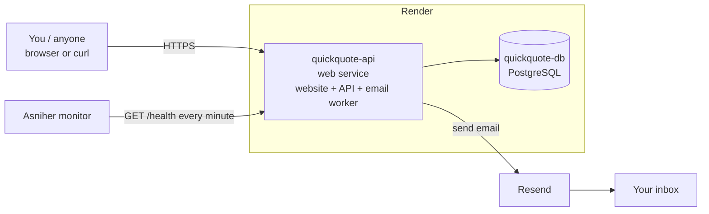

# Quotiva — Deployment and Monitoring Guide (Phases 3 and 11)

This guide puts Quotiva online (the website, the API, the email worker and the database) and connects it to **Asniher**, so you get an alert when it goes down. Follow the steps in order. It takes about 20–30 minutes.

> **In simple terms:** Render runs our code and our PostgreSQL database on the internet. Resend delivers the emails. Asniher calls `GET /health` every minute and warns you if the answer is not "200 OK".

---

## What you will have at the end



- **A live website and API on one address**, for example `https://quickquote-api.onrender.com` (Render picks the exact name). The API server also serves the built website, so the login cookie works without extra setup.
- **A PostgreSQL database** on Render.
- **Real emails** sent through Resend.
- **An Asniher monitor** on `/health`, plus a screenshot of it for the README.

Everything Render needs is already described in [`render.yaml`](../render.yaml) at the root of the repository, which Render calls a **Blueprint**. You do not have to type build or start commands yourself.

---

## Before you start

| Account | Why | Cost |
|---|---|---|
| GitHub | The code is already at `onurshaqiridev-maker/QuickQuote` | Free |
| [Render](https://render.com) | Runs the API, the worker and the database | Free plan is enough |
| [Resend](https://resend.com) | Sends the emails | Free plan is enough |
| [Asniher](https://asniher.com) | Monitors `/health` | — |

Have one **email address of your own** ready. You will use it for the admin account and to receive test emails.

---

## Step 1: Get a Resend API key

1. Sign up at Resend **with the email address you want to receive test emails at**.
2. Open **API Keys** → **Create API key**. Name it `quickquote`, and give it **Sending access**.
3. Copy the key. It starts with `re_`. You only see it once, so keep it somewhere safe for Step 2. **Never** put it in a file in the repository.

> **Important: the test sender.** Until you verify your own domain in Resend, emails are sent from `onboarding@resend.dev`. That sender can **only deliver to your own Resend account email**. That is fine for this project: in Step 2 we set the admin email to your own address, so the test emails arrive. Emails to other addresses will show as `failed` after their retries, with a message from Resend explaining why. To send to anyone, add and verify a domain in Resend (**Domains** → **Add domain**, then add the DNS records it shows). After that, change `EMAIL_FROM` in Render to an address on that domain.

---

## Step 2: Deploy on Render with the Blueprint

1. Sign up at Render (**Sign in with GitHub** is easiest).
2. Click **New +** → **Blueprint**.
3. Connect your GitHub account if asked, and choose the repository **QuickQuote**. Render finds `render.yaml` automatically.
4. Give the Blueprint a name, for example `quickquote`.
5. Render shows what it will create: **quickquote-db** (PostgreSQL) and **quickquote-api** (web service). It also asks for the secret values:

   | Variable | What to enter |
   |---|---|
   | `RESEND_API_KEY` | The `re_...` key from Step 1 |
   | `ADMIN_NOTIFICATION_EMAIL` | Your own email (the same as your Resend account) |
   | `SEED_ADMIN_EMAIL` | Your own email. It becomes the admin login. |
   | `SEED_ADMIN_PASSWORD` | A strong password for the admin login (at least 8 characters) |

   All other values are filled in automatically. `JWT_SECRET` is generated randomly, and `DATABASE_URL` is connected to the new database.
6. Click **Apply** (or **Deploy Blueprint**).
7. Open **quickquote-api** → **Logs** and watch. It takes a few minutes. You should see:
   ```
   ### MIGRATION 001_extensions-and-helpers (UP) ###
   ...
   ### MIGRATION 013_add-password-changed-at (UP) ###
   Seed finished:
     categories created: 12 (of 12)
     plans created:      3 (of 3)
     admin:              created (you@example.com)
   {"level":30,...,"msg":"Email worker started"}
   {"level":30,...,"msg":"API server listening on http://localhost:10000  (health: /health)"}
   ```
   (Render tells the app which port to use. The "localhost" in this line is normal.)
8. At the top of the service page, copy your public URL, for example `https://quickquote-api.onrender.com`.

**What happens on each deploy?** The build command builds the website (`frontend/dist`) and the API. The start command first applies any new migrations, then makes sure the seed data exists, then starts the API and the email worker together (`dist/src/all.js`). Every push to the branch triggers a new deploy automatically.

---

## Step 3: Check that it works

Replace `https://YOUR-URL` with your Render URL. You can paste the `curl` commands into a terminal, or open the GET URLs in a browser.

1. The website opens: visit `https://YOUR-URL` in your browser. You see the Quotiva homepage. Click **Log in** and use your admin email and password: you land on the admin overview. The API answers too:
   ```bash
   curl https://YOUR-URL/api/categories
   ```
   ```json
   { "data": [ { "name": "Beauty & Wellness", "slug": "beauty-wellness", ... }, ... ] }
   ```

2. The health check returns 200:
   ```bash
   curl -i https://YOUR-URL/health
   ```
   ```json
   HTTP/2 200
   { "status": "ok", "checks": { "app": "ok", "database": "ok" }, ... }
   ```

3. A real email goes through the queue. The contact form sends to `ADMIN_NOTIFICATION_EMAIL`, which is you:
   ```bash
   curl -i -X POST https://YOUR-URL/api/contact \
     -H "Content-Type: application/json" \
     -d '{"name":"Deploy Test","email":"test@example.com","subject":"It works","message":"My first email through the Quotiva queue."}'
   ```
   The answer is `202 Accepted` immediately. Within a few seconds the email "[Contact] It works" arrives in your inbox. Check the spam folder too.

4. See the queue as admin:
   ```bash
   curl -s -c admin.txt -X POST https://YOUR-URL/api/auth/login \
     -H "Content-Type: application/json" \
     -d '{"email":"YOUR-ADMIN-EMAIL","password":"YOUR-ADMIN-PASSWORD"}'
   ```
   ```bash
   curl -s -b admin.txt https://YOUR-URL/api/admin/email-jobs/stats
   ```
   ```json
   { "data": { "pending": 0, "sent": 1, "failed": 0 } }
   ```

If one of these fails, see [Troubleshooting](#troubleshooting).

---

## Step 4: Create the Asniher monitor

Create a new **HTTP / website monitor** in Asniher with these settings. Names can differ slightly in its interface.

| Setting | Value |
|---|---|
| URL | `https://YOUR-URL/health` |
| Method | `GET` |
| Check interval | Every **1 minute** (or the shortest your plan allows) |
| Expected status code | `200` |
| Timeout | **30–60 seconds** (see the note on free plans below) |
| Optional keyword check | The body contains `"database":"ok"` |
| Alerts | Your email (and/or another channel you like) |

What the monitor sees:

| Situation | `/health` answer | Asniher shows |
|---|---|---|
| Everything works | `200` with `"database":"ok"` | Up |
| The database is unreachable or slower than 2 s | `503` with `"database":"unreachable"` | Down, and you get an alert |
| The app itself has crashed | No answer, or an error from Render | Down, and you get an alert |

**Optional test of the alert:** in Render, open **quickquote-db** and temporarily **suspend** it (if your plan offers that), or temporarily change `DATABASE_URL` on the web service to a wrong value. `/health` turns `503` and Asniher should alert. Undo the change afterwards.

---

## Step 5: Screenshot and README

1. When the monitor has been green for a little while, take a **screenshot** of it in Asniher. It should show the URL, the "up" status and the response times.
2. Save it as **`docs/images/asniher-monitor.png`**. Either:
   - send it to me in the chat, and I will add it to the repository and the README, or
   - upload it yourself on GitHub: open the `docs` folder → **Add file** → **Upload files** → put it in a new `images` folder.
3. Tell me your Render URL, and I will add it to the README as the **Live URL**.

---

## Free plan: good to know

| Topic | What it means for us |
|---|---|
| **No free background workers** | That is why `render.yaml` runs the API **and** the worker in one service (`node dist/src/all.js`). They still only communicate through the `email_jobs` table. |
| **The web service sleeps after ~15 minutes without traffic** | Asniher's checks every minute count as traffic, so the service stays awake. If it does fall asleep, the first request takes up to about a minute. That is why the monitor timeout is 30–60 seconds. |
| **Uploaded images are temporary** | The free web service has no permanent disk: logos and photos that businesses upload are **lost on every restart or deploy** (the database rows stay, the pictures show as missing). Fine for a demo. For real use, add a Render disk (paid) and set `UPLOAD_DIR` to it, or move to cloud storage (only `backend/src/services/storage.service.ts` changes). |
| **The free PostgreSQL database expires after 30 days** (with a 14-day grace period) | Fine for the assignment. To keep it running longer, upgrade the database to a paid plan in Render before it expires, or create a new one. |

### Optional: separate API and worker (paid plan)

With a paid plan you can run the worker as its own **Background Worker** service, as in the original design. Replace the `services:` part of `render.yaml` with two services that share the same environment variables:

```yaml
services:
  - type: web
    name: quickquote-api
    runtime: node
    plan: starter
    rootDir: backend
    buildCommand: npm ci --include=dev && npm run build
    startCommand: npm run migrate:deploy && npm run seed:deploy && exec node dist/src/server.js
    healthCheckPath: /health
    envVars: [ ...same as now... ]
  - type: worker
    name: quickquote-worker
    runtime: node
    plan: starter
    rootDir: backend
    buildCommand: npm ci --include=dev && npm run build
    startCommand: exec node dist/src/worker.js
    envVars: [ ...same as now... ]
```

---

## Troubleshooting

| Problem | What to check |
|---|---|
| The build fails with `tsc: not found` | Use the build command from `render.yaml`: it installs with `npm ci --include=dev` for both `frontend` and `backend` (TypeScript and Vite are dev dependencies) |
| The logs say `FRONTEND_DIST_DIR: ... does not exist` | The website was not built. The build command must run `npm run build --prefix frontend` before the backend build (as in `render.yaml`). |
| The logs say `FRONTEND_URL must be the public website address in production` | Remove `FRONTEND_URL` from the environment (Render's address is used automatically), or set it to your real `https://` address. |
| A page shows "Not found" after a refresh, or you get logged out when moving around | Make sure you open the site on the Render address of **quickquote-api** itself, and that `VITE_API_URL` is **not** set in Render. |
| The logs say `Invalid environment configuration` | The message lists the missing or wrong variable. Add it under **quickquote-api → Environment**, then **Manual Deploy → Deploy latest commit**. |
| The logs show an SSL or connection error from PostgreSQL | Check that `DATABASE_URL` comes from **quickquote-db** (the *internal* connection string). If you use the *external* connection string, set `DATABASE_SSL=true`. |
| `/health` returns `503` | The app runs but cannot reach the database. Check that the database is "Available" in Render and that `DATABASE_URL` is correct. |
| Emails stay `pending` or end up `failed` | Look at `lastError` in `GET /api/admin/email-jobs?status=failed`. A message about only sending "testing emails to your own email address" means you need a verified domain in Resend, or must send to your own address. An "API key is invalid" message means `RESEND_API_KEY` is wrong. |
| No email arrives, but the job is `sent` | Check the spam folder. Resend's dashboard (**Emails**) shows every email it received from us. |
| Login as admin fails | The admin is only created if `SEED_ADMIN_EMAIL` and `SEED_ADMIN_PASSWORD` were set **before** the first start. Set them and redeploy: the seed creates the admin on the next start. |
