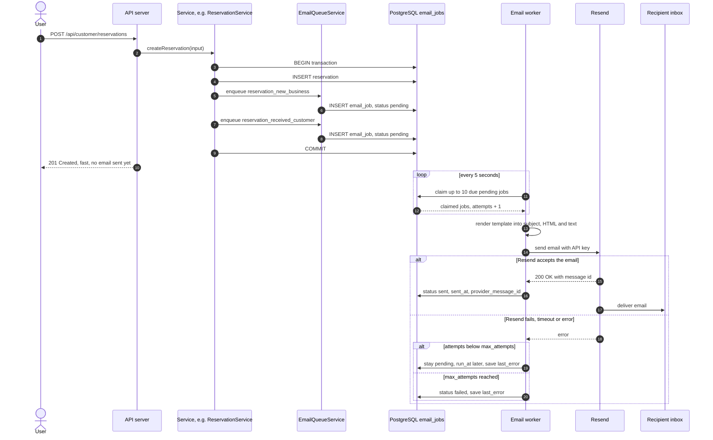
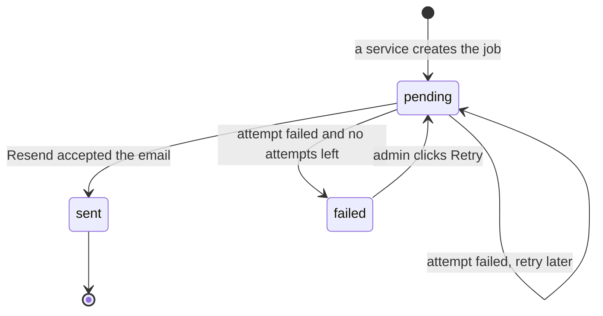
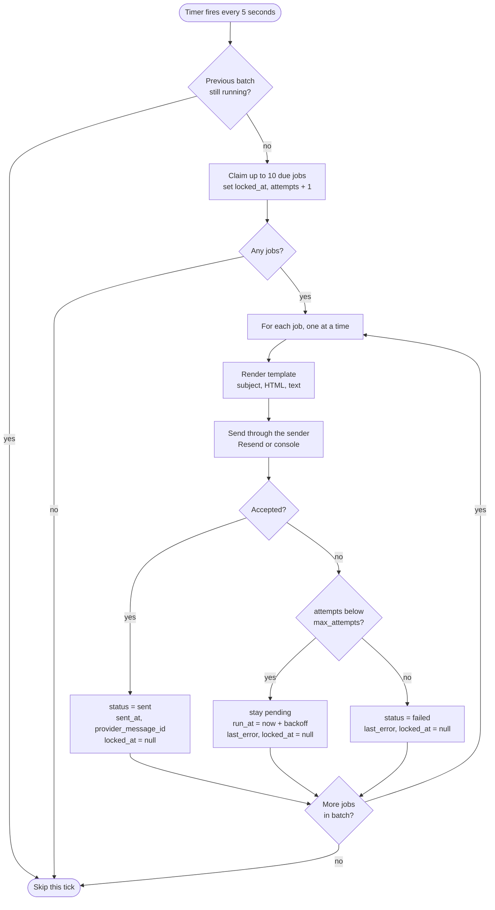

# Quick Quote — Email Workflow

This document explains how Quick Quote sends emails: through a **queue** stored in PostgreSQL and a **background worker** that delivers them with **Resend**.

---

## 1. In simple terms

Sending an email takes time and can fail. The email service might be slow, down, or might refuse because we send too fast. If the API sent emails while the user waited, the website would feel slow, and a temporary problem could break an important action like booking.

So we split the work in two:

1. **The API writes a "to-do note"** (an *email job*) into the `email_jobs` table, then answers the user right away.
2. **The worker**, a separate background program, checks the table every few seconds. It sends each email through Resend and writes down the result: `sent`, or try again later, or `failed`.

> **The golden rule:** HTTP endpoints **never** send emails. They only create email jobs.

---

## 2. Requirements and how we meet them

| Requirement | How it is met |
|---|---|
| Use Resend | The worker's `ResendSender` uses the official `resend` Node.js package |
| Endpoints must not send emails directly | Services only call `EmailQueueService.enqueue(...)`, which inserts a row. The API layer cannot even import the sender, because of the ESLint layer rules. |
| A background worker sends them | `src/worker.ts` runs `EmailWorkerService` every 5 seconds |
| Store each job's status in the database | `email_jobs.status` is one of **`pending`**, **`sent`** or **`failed`** |
| Retry failures at least 3 times | Every job gets **5 attempts in total: 1 first try + 4 retries**, with growing waits between them. `EMAIL_MAX_ATTEMPTS` must be at least 4 (that is, at least 3 retries); the app refuses to start otherwise. |

---

## 3. The parts involved

| Part | Layer / location | Job |
|---|---|---|
| `EmailQueueService` | Services (`src/services/email/email-queue.service.ts`) | Creates email jobs. This is the **only** way to "send" an email from business logic. |
| `EmailJobRepository` | Data (`src/data/repositories/email-job.repository.ts`) | All SQL for `email_jobs`: insert, claim, mark sent, schedule retry, mark failed, list |
| `email_jobs` table | PostgreSQL | The queue itself, with each job's status and history |
| `EmailWorkerService` | Services (`src/services/email/email-worker.service.ts`) | Claims jobs, renders templates, calls the sender and records results |
| Email templates | Services (`src/services/email/templates/`) | Turn a template name + payload into a subject, HTML and plain text |
| Email senders | Services (`src/services/email/senders/`) | `ConsoleSender` prints the email (development). `ResendSender` really sends it. |
| `worker.ts` | Entry point (`src/worker.ts`) | Starts the timer loop and calls `EmailWorkerService` |
| Resend | Outside service | Delivers the email to the inbox |

---

## 4. Email queue workflow diagram

### 4.1 From user action to inbox



### 4.2 Email job statuses



| Status | Meaning |
|---|---|
| `pending` | Waiting to be sent, or waiting for its next retry. If `locked_at` is set and recent, a worker is sending it right now. |
| `sent` | Resend accepted the email. Final. |
| `failed` | All attempts failed. It stays visible in the admin dashboard until an admin retries it. |

---

## 5. Creating a job

### 5.1 Inside the same transaction

An email job is always created **in the same database transaction** as the change that caused it. For example, the reservation and its two email jobs are saved together.

- If saving the reservation fails, the email jobs are also undone, so no email goes out about a booking that does not exist.
- If the reservation is saved, its email jobs are guaranteed to exist, so no booking is ever missing its email.

This pattern is called the **transactional outbox**. Using PostgreSQL as the queue makes it easy. A separate queue system like Redis cannot take part in a PostgreSQL transaction.

### 5.2 What a job contains

```json
{
  "to_email": "hello@bellahair.example",
  "template": "reservation_new_business",
  "payload": {
    "businessName": "Bella Hair Studio",
    "customerName": "Sara Miller",
    "serviceName": "Women's haircut",
    "localDateTime": "Tuesday, 10 November 2026 at 09:30",
    "customerNotes": "First visit. I would like a short bob.",
    "dashboardUrl": "https://quickquote.example/dashboard/reservations?id=r55c..."
  },
  "status": "pending",
  "attempts": 0,
  "max_attempts": 5,
  "run_at": "2026-11-01T12:00:00Z"
}
```

- The payload holds a **snapshot** of everything the email needs, already formatted. Dates are formatted in the business's time zone. The worker does not need to look anything else up.
- Links are built from `FRONTEND_URL`.

### 5.3 The enqueue function

`EmailQueueService.enqueue({ to, template, payload, dedupeKey?, runAt? }, tx?)`:

- checks that `template` is a known template name,
- inserts the row through `EmailJobRepository.insert(...)`, using the transaction `tx` if one is given,
- skips the insert quietly if a job with the same `dedupeKey` already exists.

---

## 6. The worker loop step by step



### 6.1 Claiming jobs safely

```sql
UPDATE email_jobs
SET    locked_at  = now(),
       attempts   = attempts + 1,
       updated_at = now()
WHERE  id IN (
  SELECT id
  FROM   email_jobs
  WHERE  status = 'pending'
    AND  run_at <= now()
    AND  (locked_at IS NULL OR locked_at < now() - interval '10 minutes')
  ORDER  BY run_at
  LIMIT  $1
  FOR UPDATE SKIP LOCKED
)
RETURNING *;
```

What each part does:

- `status = 'pending' AND run_at <= now()`: only jobs that are due. Jobs waiting for a retry have a future `run_at`.
- `locked_at IS NULL OR locked_at < now() - 10 minutes`: skip jobs another worker is sending right now. If a worker crashed in the middle of sending, its lock **expires after 10 minutes** and the job is picked up again automatically. No separate "recovery" task is needed.
- `FOR UPDATE SKIP LOCKED`: if two workers run at the same moment, each one skips the rows the other has just locked. **No email is claimed twice.**
- `attempts = attempts + 1`: the attempt is counted at claim time, so a crash still counts as an attempt.

### 6.2 After sending

| Result | SQL (in `EmailJobRepository`) |
|---|---|
| Success | `SET status = 'sent', sent_at = now(), provider_message_id = $2, last_error = NULL, locked_at = NULL` |
| Failure, attempts left | `SET run_at = now() + <backoff>, last_error = $2, locked_at = NULL` (status stays `pending`) |
| Failure, no attempts left | `SET status = 'failed', last_error = $2, locked_at = NULL` |

### 6.3 Shutting down cleanly

When the hosting platform stops the worker (for example during a deploy), it sends a `SIGTERM` signal. The worker then:

1. stops starting new batches,
2. finishes the email it is currently sending and records the result,
3. closes the database pool and exits.

If it is killed anyway, the 10-minute lock expiry makes sure nothing is lost.

---

## 7. Retries

### 7.1 Retry schedule

Each failure waits longer than the one before. This is called **backoff**. It gives a temporary problem time to go away.

| Attempt | When it happens | If it fails |
|---|---|---|
| 1 (first try) | Within ~5 seconds of being queued | Retry in **1 minute** |
| 2 (retry 1) | ~1 minute later | Retry in **5 minutes** |
| 3 (retry 2) | ~5 minutes later | Retry in **15 minutes** |
| 4 (retry 3) | ~15 minutes later | Retry in **60 minutes** |
| 5 (retry 4) | ~60 minutes later | Status becomes **`failed`** |

That makes **4 retries**, more than the required 3, over about 1 hour 20 minutes. The schedule is a simple list in `email-worker.service.ts`: `[1, 5, 15, 60]` minutes.

### 7.2 What counts as a failure

Any error while rendering or sending counts as a failed attempt:

- network errors and timeouts (Resend didn't answer within 10 seconds),
- Resend errors, including "too many requests" (HTTP 429) and server errors (5xx),
- Resend refusing the email (for example, an invalid sender address),
- a bug in a template.

To keep things simple, **every failure is retried** until the attempts run out. The error message is saved in `last_error`, so the admin can see what went wrong.

### 7.3 Retrying by hand

The admin dashboard lists `failed` jobs with their `last_error`. **Retry** (`POST /api/admin/email-jobs/:id/retry`) sets:

- `status = 'pending'`,
- `attempts = 0`,
- `run_at = now()`.

The worker then picks the job up again.

---

## 8. Avoiding duplicate emails

| Risk | Protection |
|---|---|
| Two workers send the same job | `FOR UPDATE SKIP LOCKED` when claiming |
| Resend accepted the email, but the worker crashed before writing `sent`, so the job is retried | The job ID is passed to Resend as an **idempotency key** (`email-job/<id>`). Resend ignores a repeated send with the same key. |
| The hourly subscription check queues the same reminder twice | `dedupe_key` (unique), for example `renewal-reminder:<subscription id>:<period end>:7d` |
| A user double-clicks a button | The action itself is protected (for example, the reservation status can only change once), so only one email job is created |

---

## 9. Email catalog

Every email the platform sends:

| # | Template | Sent when | To | Content |
|---|---|---|---|---|
| 1 | `customer_welcome` | A customer registers | Customer | Welcome + "Confirm your email" link |
| 2 | `business_welcome` | A business registers | Business owner | Welcome + confirm-email link + next steps (choose plan, complete profile) |
| 3 | `admin_new_business` | A business registers | Admin (`ADMIN_NOTIFICATION_EMAIL`) | "New business waiting for review" + link |
| 4 | `verify_email` | User clicks "Resend confirmation email" | User | Confirm-email link |
| 5 | `password_reset` | User asks to reset their password | User | Reset link (valid 1 hour) |
| 6 | `reservation_new_business` | A customer books | Business | Customer, service, date, time, notes + link to confirm |
| 7 | `reservation_received_customer` | A customer books | Customer | "Your request was sent, waiting for confirmation" + details |
| 8 | `reservation_confirmed_customer` | The business confirms | Customer | Confirmed details + business address |
| 9 | `reservation_rejected_customer` | The business rejects | Customer | Rejection + the business's message |
| 10 | `reservation_cancelled_customer` | The business, or the system, cancels | Customer | Cancellation + reason |
| 11 | `reservation_cancelled_business` | The customer cancels | Business | Which booking was cancelled + reason |
| 12 | `quote_new_business` | A customer sends a quote request | Business | Subject, description, budget, preferred date + link |
| 13 | `quote_received_customer` | A customer sends a quote request | Customer | "Your request was sent" + summary |
| 14 | `quote_status_customer` | The business sets a request to processing, completed or rejected | Customer | New status. When completed: the quoted price and message. |
| 15 | `subscription_activated` | First payment received | Business | Plan, period end date, next steps to go live |
| 16 | `payment_receipt` | Any payment is marked paid | Business | Amount, plan, period covered |
| 17 | `payment_failed` | A payment is marked failed | Business | What happened + how to try again |
| 18 | `subscription_renewal_reminder` | 7 days and 1 day before the period ends | Business | End date + "Renew now" link |
| 19 | `subscription_past_due` | The period ended without renewal | Business | "3-day grace period. Renew to stay visible." |
| 20 | `subscription_expired` | The grace period ended | Business | "Your profile is hidden" + renew link |
| 21 | `subscription_cancelled` | A cancelled subscription reaches its end | Business | Confirmation + "come back any time" |
| 22 | `business_approved` | The admin approves the business | Business | "You are approved" + remaining go-live steps |
| 23 | `business_suspended` | The admin suspends or deactivates the business | Business | Status + reason + contact info |
| 24 | `contact_message_admin` | Someone uses the Contact form | Admin | Name, email, subject, message |

---

## 10. Templates

- Each template is a small TypeScript function in `src/services/email/templates/` that takes the payload and returns `{ subject, html, text }`.
- One shared `layout()` function adds the logo header, footer and simple inline styles, so every email looks consistent.
- Every email has both an **HTML** and a **plain-text** version, which helps spam filters and simple email apps.
- **User-written text** (notes, messages) is **HTML-escaped** before it goes into the HTML, so nobody can inject code into an email.
- Dates and times are formatted in the **business's time zone** when the job is created, and stored ready-made in the payload.
- Version 1 is in English. The template structure allows translations later.

---

## 11. Development and production

| Setting | Development | Production |
|---|---|---|
| `EMAIL_DRIVER` | `console`: the email is printed in the worker's terminal and marked `sent`. No Resend account needed. | `resend` |
| `RESEND_API_KEY` | Not needed | Required. Stored only in the host's environment settings, never in Git. |
| `EMAIL_FROM` | Anything | An address on a **domain verified in Resend**, for example `Quick Quote <noreply@quickquote.example>` |

**Testing retries without breaking anything:** with the `console` driver, any recipient ending in **`@fail.test`** always fails. Register a test user like `demo@fail.test` and you can watch the job go through 5 attempts and end up `failed`. This only works when `NODE_ENV` is not `production`.

**Setting up Resend for production:**

1. Create a Resend account and an API key with "sending" permission.
2. Add and verify your domain in Resend by adding the DNS records it shows you (SPF and DKIM).
3. Set `EMAIL_DRIVER=resend`, `RESEND_API_KEY` and `EMAIL_FROM` in the hosting platform's settings.
4. Before your domain is verified, Resend's test sender (`onboarding@resend.dev`) only delivers to your own account email. That is fine for a quick test.

---

## 12. Monitoring the queue

| Where | What you see |
|---|---|
| Admin overview | Number of `pending` jobs, `failed` jobs, and the oldest pending job's age. If that age keeps growing, the worker is probably down. |
| Admin email jobs list | Every job with status, attempts, `last_error`, and a **Retry** button for failed jobs |
| Worker logs | One line per job, for example `email_job=… template=reservation_new_business result=sent attempt=1` |

---

## 13. Configuration

| Variable | Default | Meaning |
|---|---|---|
| `EMAIL_DRIVER` | `console` | `console` or `resend` |
| `RESEND_API_KEY` | — | Required when `EMAIL_DRIVER=resend` |
| `EMAIL_FROM` | — | Sender name and address |
| `ADMIN_NOTIFICATION_EMAIL` | — | Receives admin notifications |
| `EMAIL_POLL_INTERVAL_MS` | `5000` | How often the worker checks for jobs |
| `EMAIL_BATCH_SIZE` | `10` | Jobs claimed per check |
| `EMAIL_MAX_ATTEMPTS` | `5` | Attempts per job (minimum `4`, meaning at least 3 retries) |
| `EMAIL_SEND_TIMEOUT_MS` | `10000` | How long to wait for Resend before counting the attempt as failed |
| `EMAIL_LOCK_TIMEOUT_MINUTES` | `10` | After this time, a claimed job that was never finished can be claimed again |

---

## 14. Future improvements

- Notification preferences (for example, a business can turn off "reservation cancelled" emails)
- Appointment reminder emails 24 hours before the start
- Treat permanent errors (like an invalid address) as failed right away, instead of retrying
- Translations
- Use Resend webhooks to record "delivered", "bounced" and "opened"
