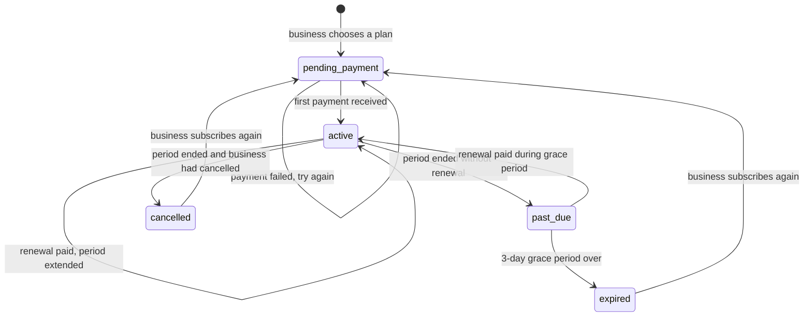

# Quotiva — Subscription Model

This document explains how businesses pay for Quotiva: plans, subscription statuses, payments, renewal and expiration.

> **Important:** Real payment processing is **not** part of version 1 until the architecture is approved. The design below works with a **mock (pretend) payment provider** and **manual bank transfers**. A real provider such as Stripe can be added later by writing one new provider file.

---

## 0. Free launch (current setting)

**Quotiva starts free for businesses.** Payments are not part of the first release.

| Setting | `SUBSCRIPTIONS_REQUIRED=false` (default, free launch) | `SUBSCRIPTIONS_REQUIRED=true` (later, paid) |
|---|---|---|
| Go-live checklist | No "Choose a plan and pay" step | Includes "Choose a plan and pay" |
| Publishing | Works without a subscription | Needs an active subscription |
| Public visibility | Published + approved by an admin | Published + approved + active subscription |
| Limits | Starter limits for everyone (10 services, 5 photos) | The plan's limits |
| Pricing page | Shows "Free during our launch"; plans marked "after launch" | Normal plans with "Get started" buttons |
| Business "Subscription" page | Explains the free launch and shows usage | Plan, payments and renewal (phase 6) |

The website asks `GET /api/config` which mode is active. Everything described below (plans, statuses, payments) is the design for when payments are switched on. Turning them on later is one setting plus building phase 6; no other code changes.

---

## 1. In simple terms

- **Customers never pay.**
- **Businesses pay a monthly fee.** As long as they have paid for the current month, their profile can be public and they receive reservations and quote requests.
- If they don't renew, they get **3 extra days** (grace period). After that, their profile is hidden until they pay again.
- Every payment is recorded, so both the business and the admin can see the full payment history.

---

## 2. Who pays what

| Account type | Price | What they get |
|---|---|---|
| Customer | **Free** | Search, view profiles, request quotes, book appointments, history |
| Business | **Monthly subscription** | Public profile, services and prices, reservations, quote requests, dashboard, email notifications |
| Administrator | — | Internal account |

---

## 3. Initial pricing

A simple first pricing structure with three monthly plans. Prices are in euros, **prepaid for one month**. The admin can change prices and limits at any time in the admin dashboard.

| | **Starter** | **Professional** | **Premium** |
|---|---|---|---|
| Price per month | **€19** | **€39** | **€59** |
| `code` | `starter` | `professional` | `premium` |
| Public business profile | Yes | Yes | Yes |
| Reservations and quote requests | Yes | Yes | Yes |
| Email notifications | Yes | Yes | Yes |
| Services listed | up to 10 | up to 30 | unlimited |
| Photos | up to 5 | up to 20 | up to 50 |
| Featured on the homepage + listed first in search + "Featured" badge | — | — | Yes |

Stored in `subscription_plans` as:

| code | price_cents | max_services | max_photos | is_featured |
|---|---|---|---|---|
| `starter` | 1900 | 10 | 5 | false |
| `professional` | 3900 | 30 | 20 | false |
| `premium` | 5900 | NULL (unlimited) | 50 | true |

---

## 4. What a subscription unlocks

| Feature | Without an active subscription | With an active subscription |
|---|---|---|
| Log in and use the dashboard | Yes | Yes |
| Edit profile, services, working hours and settings | Yes (to prepare, within the Starter plan limits) | Yes (within their plan's limits) |
| Publish the profile | No | Yes (if the profile is complete. It becomes visible once an admin approves it.) |
| Appear in search and on a public profile page | No | Yes |
| Receive new reservations and quote requests | No | Yes |
| Manage existing reservations and quotes | Yes (so customers are never left waiting) | Yes |

---

## 5. Subscription statuses



| Status | Meaning | Profile visible? | Counts as "current"? |
|---|---|---|---|
| `pending_payment` | Plan chosen, waiting for the first payment | No | Yes |
| `active` | Paid. `current_period_end` is in the future. | Yes | Yes |
| `past_due` | The period ended without renewal. **3-day grace period.** | Yes (with reminders) | Yes |
| `cancelled` | The business cancelled, and the paid period has now ended | No | No (history) |
| `expired` | The grace period ended without payment | No | No (history) |

"**Current**" means it is the business's one live subscription. The database allows **at most one current subscription per business** (partial unique index, see [DATABASE_DESIGN.md](DATABASE_DESIGN.md#62-other-constraints)). When a `cancelled` or `expired` business subscribes again, a **new** subscription row is created and the old one stays as history.

---

## 6. Lifecycle walkthroughs

### 6.1 First subscription

1. The business opens **Subscription** in the dashboard and picks a plan.
2. `POST /api/business/subscription/checkout` creates:
   - a `subscriptions` row: status `pending_payment`, no period dates yet,
   - a `payments` row: status `pending`, purpose `initial`, amount = plan price.
3. The API returns the **next step**, which depends on the payment provider (see [section 8](#8-payment-providers)).
4. When the payment is confirmed:
   - payment → `paid`, `paid_at = now`, `period_start = now`, `period_end = now + 1 month`
   - subscription → `active`, `current_period_start = now`, `current_period_end = now + 1 month`
   - emails: `subscription_activated` and `payment_receipt`
5. The go-live checklist now shows "Subscription active" as done.

If the business starts checkout again while still `pending_payment` (for example, to pick another plan), the same subscription row is reused. Its plan is updated, the old pending payment is marked `failed`, and a new payment is created.

### 6.2 Renewal

Version 1 renews **manually**. Automatic renewal comes with a real payment provider.

1. From **14 days before** the period ends, the dashboard shows a **Renew** button. The business also receives reminder emails 7 days and 1 day before.
2. `POST /api/business/subscription/renew` creates a payment with purpose `renewal`. The amount is the price of `next_plan_id` if a plan change is scheduled, otherwise the current plan's price.
3. When the payment is confirmed, the new period starts:
   - **at the old `current_period_end`**, if the subscription is still `active` (no paid days are lost), or
   - **now**, if it was `past_due`.

   Then:
   - `current_period_end` = new start + 1 month
   - if `next_plan_id` was set: `plan_id = next_plan_id`, `next_plan_id = NULL`
   - status → `active`
   - email: `payment_receipt`

### 6.3 Changing plans

- `POST /api/business/subscription/change-plan` sets `next_plan_id`. **The change happens at the next renewal**, so there is no complicated partial-month calculation.
- The dashboard shows: *"You will switch to Premium on 1 December 2026."*
- **Downgrades:** if the business has more services or photos than the new plan allows, nothing is deleted. They simply cannot add more until they are below the limit.

### 6.4 Cancellation

1. `POST /api/business/subscription/cancel` sets `cancel_at_period_end = true` and `cancelled_at = now`.
2. The business **keeps everything until the paid period ends**.
3. They can undo it with `POST /api/business/subscription/resume` before the end date.
4. At the period end, the hourly check changes the status to `cancelled` and sends `subscription_cancelled`. The profile is hidden.

### 6.5 Expiration with grace period

1. The period ends, the subscription was not renewed and not cancelled → status `past_due`, email `subscription_past_due`. The profile **stays visible** for 3 days.
2. If the business renews within 3 days → back to `active`.
3. Otherwise → status `expired`, `ended_at = now`, email `subscription_expired`. The profile is hidden.
4. Existing future reservations are **not** cancelled automatically. The business can still see and manage them.

---

## 7. Payments

### 7.1 One payment row per paid period

Every attempt to pay creates a row in `payments`. Together they form the **payment history**.

| Field | Example |
|---|---|
| `purpose` | `initial` or `renewal` |
| `amount_cents`, `currency` | `3900`, `EUR` |
| `status` | `pending` → `paid` (or `failed`, and later maybe `refunded`) |
| `provider` | `mock`, `manual` (later `stripe`) |
| `provider_reference` | Bank transfer reference like `QQ-PAY1-7F3A`, or a Stripe ID later |
| `period_start`, `period_end` | The month this payment covers |

### 7.2 Payment statuses

| Status | Meaning |
|---|---|
| `pending` | Created, waiting for confirmation |
| `paid` | Money received. The subscription was activated or extended. |
| `failed` | The payment did not happen. The business can try again. |
| `refunded` | Money returned (admin action, reserved for later) |

---

## 8. Payment providers

All payment logic goes through a small **provider** module, so the rest of the system does not care how the money arrives.

```
PaymentService  ──uses──>  PaymentProvider (one shared shape)
                               ├── MockPaymentProvider     (development)
                               ├── ManualPaymentProvider   (bank transfer, early production)
                               └── StripePaymentProvider   (later)
```

Every provider does two things:

1. **Start a payment:** given a `payments` row, return the "next step" for the frontend.
2. **Confirm a payment:** turn a confirmation (a button click, an admin action, or later a webhook) into a call to `PaymentService.markPaid(paymentId, reference)`.

`PaymentService.markPaid` is the **single place** that marks a payment as paid and asks `SubscriptionService` to activate or extend the subscription. Every provider ends up there.

The provider is chosen by the `PAYMENT_PROVIDER` environment variable.

### 8.1 Mock provider (`PAYMENT_PROVIDER=mock`)

1. The next step is `{ "type": "mock_checkout", "url": "/dashboard/subscription/checkout/<paymentId>" }`.
2. The frontend shows a simple **pretend checkout page** with two buttons: **Simulate successful payment** and **Simulate failed payment**.
3. Each button calls `POST /api/business/payments/:id/mock-complete`.
4. This endpoint **only works** when `PAYMENT_PROVIDER=mock` and `NODE_ENV` is not `production`.

### 8.2 Manual provider (`PAYMENT_PROVIDER=manual`)

For a real launch before card payments exist:

1. The next step is `{ "type": "bank_transfer", "instructions": "...", "reference": "QQ-PAY1-7F3A" }`. The instructions come from `MANUAL_PAYMENT_INSTRUCTIONS`.
2. The business transfers the money and puts the reference in the transfer description.
3. The admin sees the money arrive in the bank account. In **Admin → Subscriptions → Payments** they click **Mark as paid**, which calls `POST /api/admin/payments/:id/mark-paid`.
4. The subscription is activated or extended automatically.

### 8.3 Stripe (later, not in version 1)

1. The next step will be `{ "type": "redirect", "url": "<Stripe Checkout URL>" }`.
2. Stripe calls a new endpoint `POST /api/webhooks/stripe` when a payment succeeds.
3. That endpoint checks Stripe's signature, then calls `PaymentService.markPaid(...)`, the same function the other providers use.
4. Stripe can also renew automatically every month. We would then add a "renews automatically" flag.

---

## 9. Plan limits

| Limit | Checked in | When | Error |
|---|---|---|---|
| `max_services` | `OfferingService.create` | Adding a service (archived services don't count) | `403 PLAN_LIMIT_REACHED` |
| `max_photos` | `ProfileService.addPhoto` | Uploading a photo | `403 PLAN_LIMIT_REACHED` |
| `is_featured` | `public-business.repository.ts` | Sorting search results and choosing homepage businesses | — |

Services ask `SubscriptionService.getPlanLimits(businessId)` for the limits. When there is no current subscription, it returns the **Starter** limits, so a new business can prepare its profile before paying.

---

## 10. Public visibility rule

A business appears publicly **only if all of these are true**:

1. The **subscription** is `active` or `past_due`
2. The **business** is `approved` by an admin
3. The **profile** is published (`is_published = true`)
4. The **owner's account** is `active`

The SQL for this rule lives in one place (see [DATABASE_DESIGN.md → 8.1](DATABASE_DESIGN.md#81-which-businesses-are-publicly-visible)).

---

## 11. Automatic checks

The worker runs `MaintenanceService.runSubscriptionChecks()` **every hour**:

| Check | Condition | Action | Email |
|---|---|---|---|
| 7-day reminder | `active`, not cancelling, period ends within 7 days | Send once (`dedupe_key`) | `subscription_renewal_reminder` |
| 1-day reminder | `active`, not cancelling, period ends within 1 day | Send once (`dedupe_key`) | `subscription_renewal_reminder` |
| End of a cancelled period | `active`, `cancel_at_period_end = true`, period ended | → `cancelled`, `ended_at = now` | `subscription_cancelled` |
| End of an unpaid period | `active`, not cancelling, period ended | → `past_due` | `subscription_past_due` |
| Grace period over | `past_due`, period ended more than 3 days ago | → `expired`, `ended_at = now` | `subscription_expired` |

Every change is also written to `activity_logs` (for example `subscription.expired`), with no user as the actor, because the system did it.

---

## 12. Subscription emails

| Template | When |
|---|---|
| `subscription_activated` | First payment confirmed |
| `payment_receipt` | Any payment confirmed |
| `payment_failed` | A payment marked failed |
| `subscription_renewal_reminder` | 7 days and 1 day before the period ends |
| `subscription_past_due` | The period ended without renewal |
| `subscription_expired` | The grace period ended |
| `subscription_cancelled` | A cancelled subscription reached its end |

Full catalog: [EMAIL_WORKFLOW.md](EMAIL_WORKFLOW.md#9-email-catalog).

---

## 13. Keeping subscriptions separate

The requirements ask to keep subscription management separate from the business profile logic. We do it like this:

| Separation | How |
|---|---|
| Separate tables | `subscription_plans`, `subscriptions` and `payments` have no columns mixed into `businesses` or `business_profiles` |
| Separate services | `SubscriptionService` and `PaymentService` own all subscription and payment rules. `ProfileService` contains no payment logic. |
| Separate repositories | `plan.repository.ts`, `subscription.repository.ts`, `payment.repository.ts` |
| A small, clear connection | Other services ask `SubscriptionService` only three questions (below). They never read subscription tables themselves. |

The only three things other services may ask:

| Method | Answer | Used by |
|---|---|---|
| `hasActiveSubscription(businessId)` | `true` / `false` | Publishing (go-live checklist) |
| `getPlanLimits(businessId)` | `{ maxServices, maxPhotos, isFeatured }` | Adding services and photos |
| `getSummary(businessId)` | Plan name, status, period end | Business overview page |

(The public visibility SQL joins the subscription table for speed. This is the one exception, and it lives in a single repository file.)

---

## 14. Admin tools

| Page / action | Endpoint |
|---|---|
| List subscriptions by status | `GET /api/admin/subscriptions` |
| See one subscription and its payments | `GET /api/admin/subscriptions/:id` |
| List payments, for example all `pending` bank transfers | `GET /api/admin/payments?status=pending` |
| Confirm a bank transfer | `POST /api/admin/payments/:id/mark-paid` |
| Mark a payment failed | `POST /api/admin/payments/:id/mark-failed` |
| Create and edit plans, change prices and limits, deactivate plans | `GET/POST/PUT /api/admin/plans` |

Price changes only affect **new payments**. A payment that already exists keeps its amount.

The admin overview shows **monthly recurring revenue (MRR)**: the sum of the monthly prices of all `active` and `past_due` subscriptions.

---

## 15. Future improvements

- Stripe card payments and automatic monthly renewal
- Yearly plans with a discount
- A free trial (for example 14 days)
- PDF invoices with VAT
- Refunds from the admin dashboard
- Coupons and launch discounts
