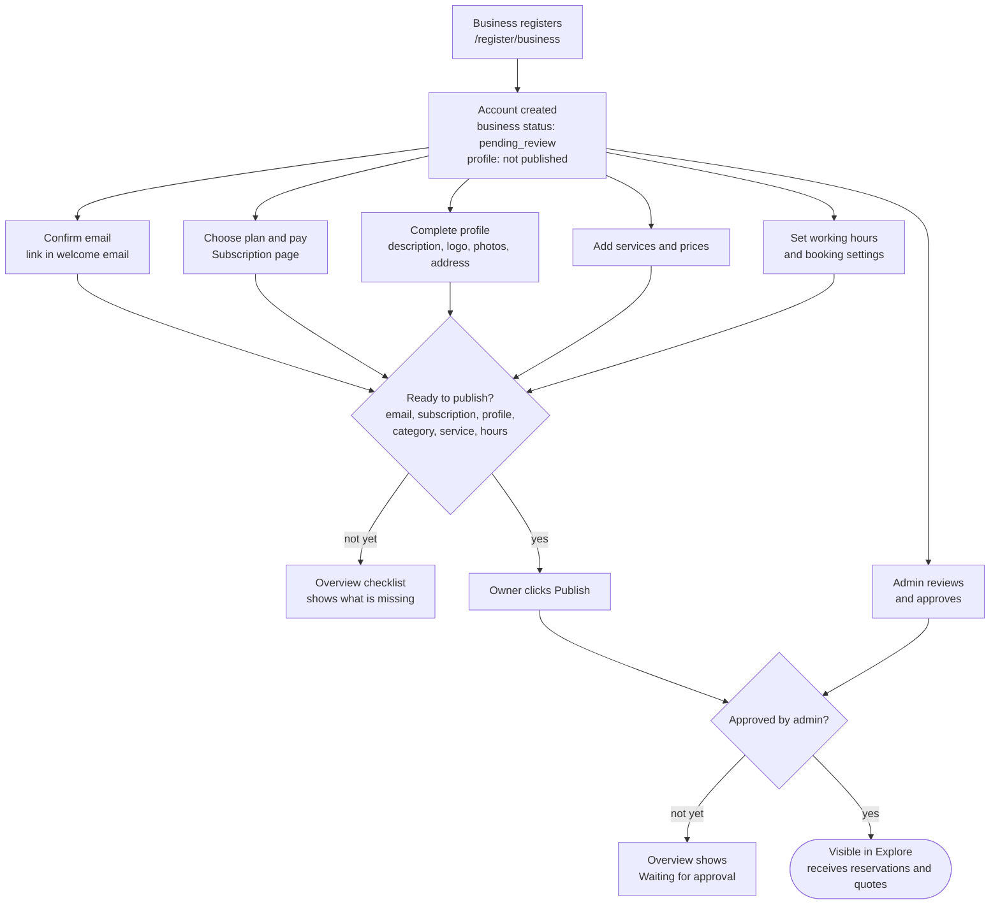
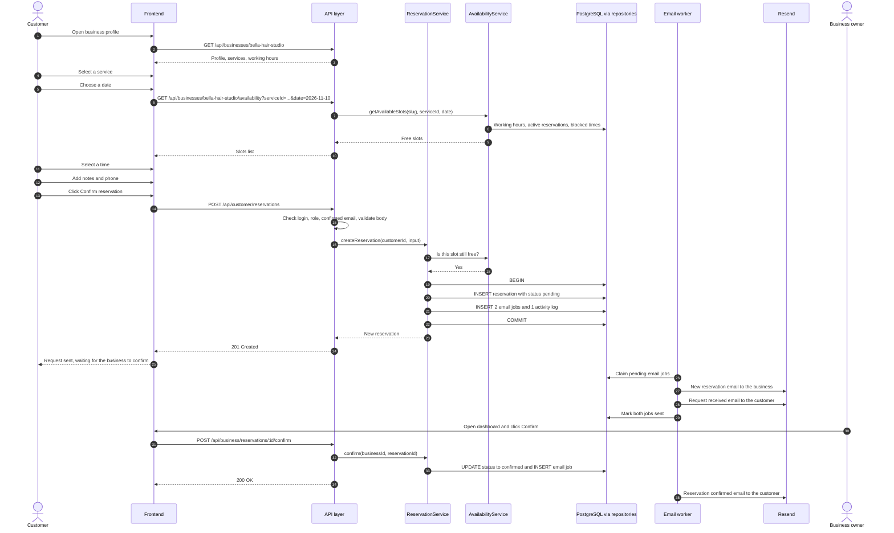
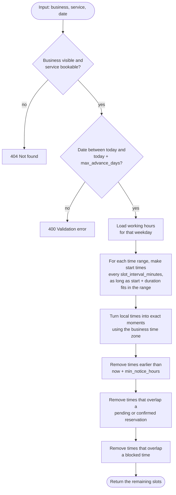
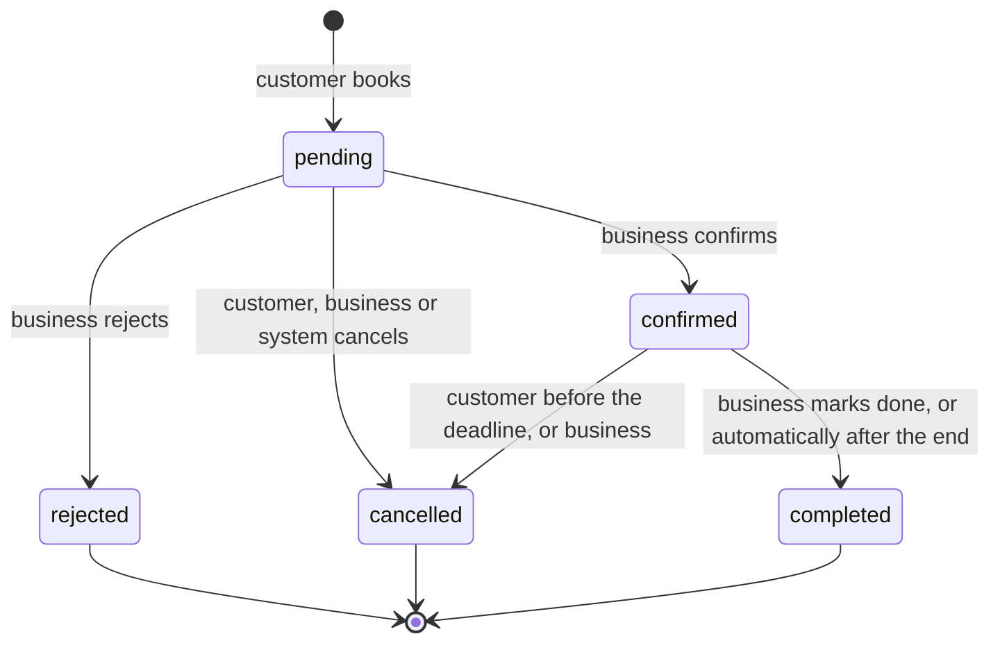
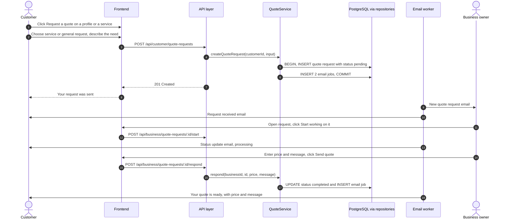
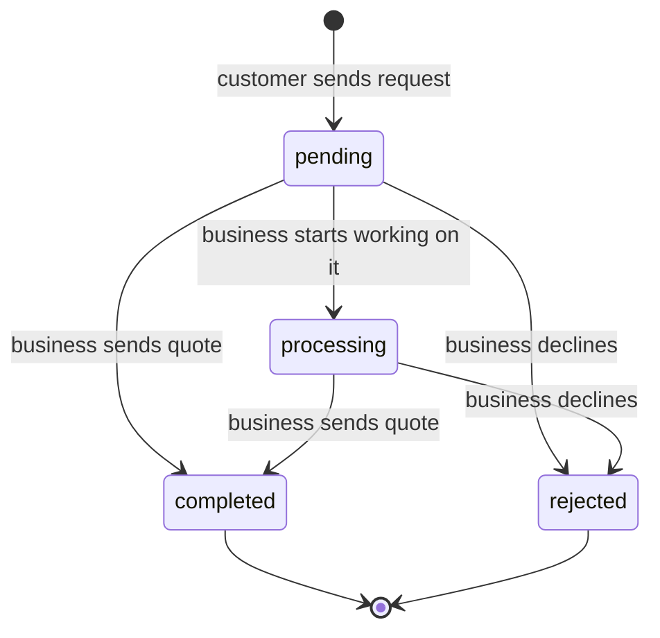

# Quick Quote — User Flows

This document walks through the main journeys **step by step**: what the user does, what the system does, and what can go wrong.

Each flow lists the pages (see [FEATURES.md](FEATURES.md#7-pages)) and endpoints (see [API_DESIGN.md](API_DESIGN.md)) involved.

---

## 1. Customer registration and email confirmation

**Pages:** Customer Registration → Customer Overview

1. The visitor clicks **Sign up** and fills in name, email, password and (optionally) phone.
2. The frontend sends `POST /api/auth/register/customer`.
3. The backend:
   - checks the input and makes sure the email is not taken,
   - saves the user with role `customer`, its password hashed,
   - creates an email-confirmation token,
   - queues the `customer_welcome` email (with the confirm link),
   - logs the user in by setting the session cookie.
4. The customer lands on **My account**. A yellow banner says *"Please confirm your email to book appointments and request quotes."*
5. The customer clicks the link in the email (`/verify-email?token=...`). The page calls `POST /api/auth/verify-email`. The backend marks `email_verified_at` and the banner disappears.

**What can go wrong**

| Problem | What happens |
|---|---|
| Email already registered | `409 EMAIL_TAKEN`: *"An account with this email already exists. Log in or reset your password."* |
| Weak password | `400 VALIDATION_ERROR`, shown next to the password field |
| Link expired (after 48 hours) | The page offers **Send a new link** (`POST /api/auth/resend-verification`) |

---

## 2. Business onboarding (going live)

**Pages:** Pricing → Business Registration → Business Overview → Subscription Management → Edit Business Profile → Manage Services → Manage Working Hours

**Steps**

1. **Register.** The owner fills in their name, email, password, business name, city, time zone and 1 to 3 categories. `POST /api/auth/register/business` creates in **one transaction**:
   - the user (`business_owner`),
   - the business (`pending_review`),
   - the profile (unpublished, slug made from the name),
   - the category links,
   - email jobs: `business_welcome` to the owner and `admin_new_business` to the admin.
2. **Business Overview** shows the **go-live checklist**. Steps can be done in any order:

   | # | Checklist item | Required to publish? |
   |---|---|---|
   | 1 | Email confirmed | Yes |
   | 2 | Subscription active | Yes |
   | 3 | Profile complete: name, description, city | Yes |
   | 4 | At least 1 category | Yes |
   | 5 | At least 1 active service | Yes |
   | 6 | Working hours set (only if a service can be booked online) | Yes |
   | 7 | Logo and photos | Recommended |
   | 8 | Approved by an admin | Required to be **visible**, not to click Publish |
   | 9 | Published | The last step |

3. **Choose a plan and pay.** See [SUBSCRIPTION_MODEL.md → First subscription](SUBSCRIPTION_MODEL.md#61-first-subscription).
4. **Publish.** `POST /api/business/profile/publish` checks items 1–6. If something is missing: `409 GO_LIVE_REQUIREMENTS_NOT_MET`, with a list of what to fix.
5. **Approval.** The admin approves the business ([flow 10](#10-admin-reviews-a-business)). The business becomes visible as soon as it is **both** published **and** approved. The order does not matter.

---

## 3. Discover businesses

**Pages:** Homepage → Explore Businesses → Business Details

1. On the **Homepage** the visitor can:
   - type a name and pick a city in the search box,
   - click a category tile,
   - click a featured business.
2. The **Explore** page opens with the matching filters in the URL, for example `/explore?search=hair&category=beauty-wellness&city=Berlin`. Because the filters are in the URL, a search can be bookmarked or shared.
3. The frontend calls `GET /api/businesses?search=hair&category=beauty-wellness&city=Berlin&page=1`.
4. Results show as cards: logo, name, city, categories, "from €25" and a Featured badge. Featured businesses come first, then the most recently published.
5. Changing a filter updates the URL and reloads the results. Pagination is at the bottom.
6. Clicking a card opens `/businesses/:slug`, which loads `GET /api/businesses/:slug`.

No login is needed to browse. Only businesses that meet the [visibility rule](SUBSCRIPTION_MODEL.md#10-public-visibility-rule) appear.

**Empty results:** *"No businesses match your search. Try another city or category."* plus a **Clear filters** button.

---

## 4. Make a reservation

**Pages:** Business Details (booking panel) → My Reservations

### 4.1 Reservation workflow diagram

**Steps in words**

1. The customer opens the business profile.
2. They **select a service**. Only active services with "bookable online" turned on show a **Book** button. Services with a price "on request" show **Request a quote** instead.
3. They **choose a date** in a small calendar. Days when the business has no working hours, and days beyond `max_advance_days`, are greyed out.
4. The frontend asks for the **free time slots** for that date and shows them as buttons (09:00, 09:30, …).
5. They **select a time**.
6. They **add extra information** (notes, phone number).
7. They **confirm**. If not logged in, they are sent to the login page and come back afterwards. If their email is not confirmed, the panel explains how to confirm it.
8. The system **saves the reservation** as `pending`, inside a transaction, together with the email jobs.
9. The **business receives** the `reservation_new_business` email.
10. The **customer receives** the `reservation_received_customer` email.
11. The business confirms (or rejects). The customer receives the matching email.

### 4.2 How free time slots are calculated

**Example.** On Tuesdays, Bella Hair Studio is open 09:00–12:00 and 13:00–17:00. Its slot interval is 30 minutes. A "Women's haircut" takes 60 minutes.

| Step | Result |
|---|---|
| Start times in the morning range | 09:00, 09:30, 10:00, 10:30, 11:00 (11:30 + 60 min would end after 12:00, so it is left out) |
| Start times in the afternoon range | 13:00, 13:30, 14:00, 14:30, 15:00, 15:30, 16:00 |
| There is already a booking 10:00–11:00 | 09:30, 10:00 and 10:30 overlap it and are removed |
| **Free slots** | **09:00, 11:00, 13:00, 13:30, 14:00, 14:30, 15:00, 15:30, 16:00** |

The same calculation runs **again** when the reservation is saved, in case something changed in between. The database's no-overlap constraint is the final protection ([DATABASE_DESIGN.md → 6.1](DATABASE_DESIGN.md#61-no-double-bookings-the-most-important-rule)).

### 4.3 Reservation statuses

| From → To | Who | Rule | Email |
|---|---|---|---|
| — → `pending` | Customer | Slot must be free. Email must be confirmed. | Business + customer |
| `pending` → `confirmed` | Business | — | Customer |
| `pending` → `rejected` | Business | Optional message | Customer |
| `pending` → `cancelled` | Customer | Before the cancellation deadline | Business |
| `pending` → `cancelled` | Business | Any time, optional message | Customer |
| `pending` → `cancelled` | System | Start time passed without an answer | Customer |
| `confirmed` → `cancelled` | Customer | At least `cancellation_notice_hours` before the start | Business |
| `confirmed` → `cancelled` | Business | Any time, optional message | Customer |
| `confirmed` → `completed` | Business | Only after the start time | — |
| `confirmed` → `completed` | System | 12 hours after the end time | — |

`rejected`, `cancelled` and `completed` are **final**. Trying to change them returns `409 INVALID_STATUS_TRANSITION`.

### 4.4 What can go wrong

| Problem | What the customer sees |
|---|---|
| Someone else booked the slot a moment earlier | `409 SLOT_UNAVAILABLE`: *"Sorry, this time was just booked. Please choose another time."* The slot list reloads. |
| Not logged in | Redirect to Login, then back to the booking panel |
| Email not confirmed | *"Please confirm your email first."* + **Resend email** button |
| Business no longer visible (for example, its subscription expired) | `404`: *"This business is not accepting bookings right now."* |
| Logged in as a business owner | The booking panel explains that bookings need a customer account |

---

## 5. Business manages reservations

**Page:** Manage Reservations (`/dashboard/reservations`)

1. The page lists reservations grouped by day. Tabs: **Pending** (needs action), **Upcoming**, **Past**, **All**.
2. Clicking a reservation opens its details:
   - service, date and time (in the business's time zone),
   - the customer's notes,
   - **customer information**: name, email, phone, and the number of earlier visits to this business.
3. Actions, depending on the status:
   - **Confirm** → `POST /api/business/reservations/:id/confirm`
   - **Reject** (with an optional message) → `.../reject`
   - **Cancel** (with an optional message) → `.../cancel`
   - **Mark as completed** (after the start time) → `.../complete`
4. Each action updates the status, queues the customer email and writes an activity log entry.
5. The **Business Overview** shows "Pending reservations: 3" and "Today's appointments", so nothing is missed.

---

## 6. Customer cancels a reservation

**Page:** My Reservations (`/account/reservations`)

1. The customer opens an upcoming reservation.
2. If `canCancel` is `true`, a **Cancel reservation** button is shown. `canCancel` is true when the status is `pending` or `confirmed` **and** the start time is at least `cancellation_notice_hours` away.
3. If it is too late, the page says: *"This reservation can no longer be cancelled online. Please contact the business directly."* and shows the business's phone number.
4. The customer confirms in a dialog and can add a reason.
5. `POST /api/customer/reservations/:id/cancel` → status `cancelled`, `cancelled_by = customer`. The business receives `reservation_cancelled_business`. The time slot becomes free again.

---

## 7. Request a quotation

**Pages:** Business Details (quote form) → My Quote Requests

### 7.1 Customer sends a request

**Steps**

1. The customer opens a business profile.
2. They click **Request a quote**, either on a specific service or as a general request.
3. They fill in:
   - **subject** (required),
   - **description** (required),
   - preferred date (optional),
   - budget (optional),
   - phone (optional).
4. They submit. This needs a login and a confirmed email, the same as booking.
5. The **business receives** `quote_new_business`.
6. The **customer receives** `quote_received_customer`.
7. The business reviews and manages the request ([7.2](#72-business-handles-the-request)).

### 7.2 Business handles the request

**Page:** Manage Quote Requests (`/dashboard/quotes`)

1. Tabs: **New** (`pending`), **In progress** (`processing`), **Answered** (`completed`, with the customer's decision), **Declined** (`rejected`).
2. A request's details show the subject, description, preferred date, budget, the service (if any) and **customer information** (name, email, phone).
3. Actions:
   - **Start working on it** → `processing`. The customer is told the business is preparing a quote.
   - **Send quote** → `completed`, with a **message** (required) and a **price** (optional, for example when the price depends on a visit).
   - **Decline** → `rejected`, with an optional message.
4. Every status change sends `quote_status_customer`.
5. The customer sees the answer in **My Quote Requests** and can **accept** or **decline** the quote (once). The business receives `quote_decision_business`. After accepting, the customer sees the business's phone and email, and the business gets the customer's contact details to plan the next steps. A chat feature may come later.

### 7.3 Quotation statuses

| Status | Shown to the customer as | Meaning |
|---|---|---|
| `pending` | "Sent" | Waiting for the business |
| `processing` | "In progress" | The business is preparing the quote |
| `completed` | "Quote received" | The business answered with a message and maybe a price |
| `rejected` | "Declined" | The business cannot take the job |

After `completed`, the customer's answer is stored next to the status in `customer_decision` (`accepted` or `declined`). The status itself stays `completed`, so the business's flow above does not change.

---

## 8. Forgot password

**Pages:** Login → Forgot Password → Reset Password

1. On the Login page, the user clicks **Forgot password?**
2. They enter their email. `POST /api/auth/forgot-password` **always** answers *"If an account exists for this email, we sent a reset link."* This way nobody can find out which emails are registered.
3. If the account exists, the backend creates a reset token (valid **1 hour**) and queues `password_reset`.
4. The user clicks the link (`/reset-password?token=...`) and enters a new password twice.
5. `POST /api/auth/reset-password` checks the token (exists, not expired, not used), saves the new password hash and marks the token as used.
6. The user is sent to Login with the message *"Password changed. Please log in."*

---

## 9. Subscription renewal and expiry

1. **14 days before** the end date: the Subscription page shows **Renew now**.
2. **7 days and 1 day before:** the business receives `subscription_renewal_reminder`.
3. The business clicks **Renew** → a renewal payment is created → mock checkout or bank transfer → when paid, the period is extended by 1 month from the old end date.
4. **If nobody pays:** at the end date the status becomes `past_due` and the profile stays visible for a **3-day grace period**. After that it becomes `expired` and the profile is hidden.
5. Paying later makes the subscription `active` again, and the profile reappears automatically (it is still published).

Full details: [SUBSCRIPTION_MODEL.md](SUBSCRIPTION_MODEL.md#6-lifecycle-walkthroughs).

---

## 10. Admin reviews a business

**Pages:** Admin Overview → Manage Businesses

1. The admin receives `admin_new_business`. The Admin Overview also shows "Businesses waiting for review: 2".
2. In **Manage Businesses**, they filter by `pending_review` and open a business. They see the owner, the profile content, categories, services, the subscription status and the go-live checklist.
3. Actions:
   - **Approve** → `approved`. The owner receives `business_approved`.
   - **Suspend** (with a reason, for example "Under investigation") → `suspended`. Hidden immediately. The owner receives `business_suspended`.
   - **Deactivate** (with a reason, for example "Fake business") → `deactivated`. Hidden permanently. The owner receives `business_suspended`.
   - **Reactivate** → back to `approved`.
4. Every action is written to `activity_logs` with the admin as the actor, so there is always a record of who did what.

Existing reservations of a suspended business stay as they are. The admin sees how many future reservations exist, so they can contact the customers if needed.

---

## 11. Admin manages the platform

| Task | Page | Steps |
|---|---|---|
| Add a category | Manage Categories | **New category** → name, icon, order → save. It appears in the filters immediately. |
| Retire a category | Manage Categories | Set it to **inactive**. It is hidden from filters and registration, but businesses keep the link. **Delete** only works if no business uses it. |
| Change a plan's price | Manage Subscriptions → Plans | Edit the price. Only new payments use the new price. |
| Confirm a bank transfer | Manage Subscriptions → Payments | Filter `pending` → find the reference → **Mark as paid** |
| Suspend a customer | Manage Customers | Open the customer → **Suspend** with a reason. They can no longer log in. |
| Check reservations or quotes | Manage Reservations / Manage Quote Requests | Filter by status, business or date (read-only) |
| Fix a failed email | Admin Overview → Email queue | Open the failed job → read `last_error` → **Retry** |

---

## 12. Contact form

**Page:** Contact

1. The visitor enters name, email, subject and message.
2. `POST /api/contact` validates the input (rate limit: 5 per hour) and queues `contact_message_admin` to `ADMIN_NOTIFICATION_EMAIL`.
3. The page shows *"Thanks! We'll reply within 2 working days."*
